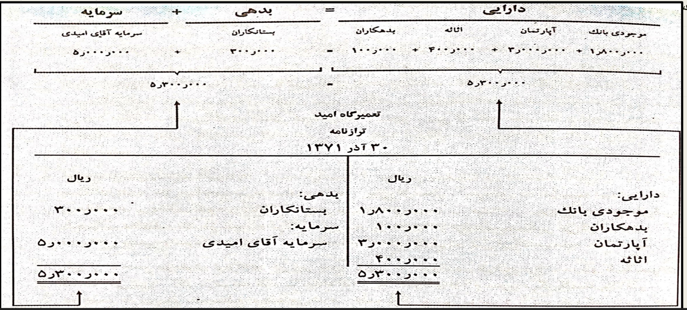
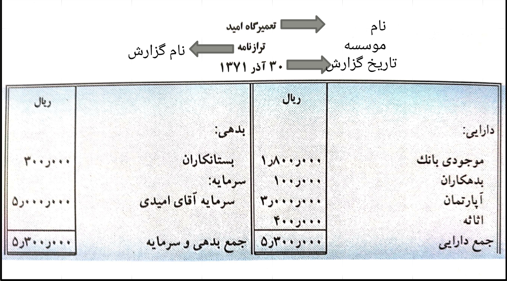

# جلسه ششم

۱۴۰۵/۰۷/۲۲

## تعمیرگاه امید
### آثار معاملات و عملیات مالی بر معادله حسابداری

| تاریخ | معاملات و عملیات مالی | دارایی | | | | = | بدهی | + | سرمایه |
| :---: | :--- | :---: | :---: | :---: | :---: | :---: | :---: | :---: | :---: |
| | | بانک | آپارتمان | اثاثه | بدهکاران | | بستانکاران | | سرمایه آقای امیدی |
| ۱۳۷۱/۹/۱ | سرمایه گذاری نقدی آقای امیدی | +۵,۰۰۰,۰۰۰ | | | | | | | +۵,۰۰۰,۰۰۰ |
| ۱۳۷۱/۹/۵ | خرید نقدی یک دستگاه آپارتمان | -۳,۰۰۰,۰۰۰ | +۳,۰۰۰,۰۰۰ | | | | | | |
| ۱۳۷۱/۹/۱۱ | خرید نسیه اثاثه اداری | | | +۸۰۰,۰۰۰ | | | +۸۰۰,۰۰۰ | | |
| ۱۳۷۱/۹/۲۰ | پرداخت بخشی از بدهی | -۵۰۰,۰۰۰ | | | | | -۵۰۰,۰۰۰ | | |
| ۱۳۷۱/۹/۲۵ | فروش نسیه بخشی از اثاثه | | | -۴۰۰,۰۰۰ | +۴۰۰,۰۰۰ | | | | |
| ۱۳۷۱/۹/۳۰ | وصول بخشی از مطالبات | +۳۰۰,۰۰۰ | | | -۳۰۰,۰۰۰ | | | | |
| مانده پایان ماه | | +۱,۸۰۰,۰۰۰ | +۳,۰۰۰,۰۰۰ | +۴۰۰,۰۰۰ | +۱۰۰,۰۰۰ | = | +۳۰۰,۰۰۰ | + | +۵,۰۰۰,۰۰۰ |
| | | ۵,۳۰۰,۰۰۰ | | | | = | ۵,۳۰۰,۰۰۰ | | |

## ترازنامه

ترازنامه یا بیلان یک گزارش یا صورت مالی است که در آن ارتباط دارایی‌ها، بدهی‌ها و سرمایه به ترتیبی گزارش می شود که برای صاحبان موسسه، بستانکاران و سایر اشخاص علاقه مند به امور مالی مفید باشد.

ترازنامه به معادله حسابداری شباهت کامل دارد. در زیر ارتباط بین معادله حسابداری و ترازنامه "تعمیرگاه امید" نشان داده شده است.

### سرفصل ترازنامه

عنوان یا سرفصل ترازنامه شامل موارد زیر است:

* نام موسسه
* نام گزارش: ترازنامه
* تاریخ گزارش: نوشتن تاریخ دارای اهمیت زیادی می باشد زیرا مبالغ مندرج در ترازنامه، وضعیت مالی موسسه را در آن تاریخ مشخص می کند.
* واحد اندازه گیری: واحد اندازه گیری معاملات در حسابداری پول رایج کشور است که در الای هر ستون مبلغ، در ترازنامه نوشته می شود.
* ترتیب نوشتن دارایی‌ها: دارایی‌ها معمولا به ترتیب قابلیت تبدیل به نقد در ترازنامه منعکس می شود یعنی اقلامی که در روال عادی عملیات سریع تر نقد می شوند در ابتدا و اقلامی که ثبات بیشتری دارند در انتهای ترازنامه می آیند؛ این قاعده، قاعده کاهش نقدینگی نام دارد.
* ترتیب نوشتن بدهی‌ها و سرمایه: سرمایه بعد از نوشتن بدهی ها در ترازنامه می آید زیرا حق بستانکاران بر حق صاحبان سرمایه تقدم دارد.
* طرز ارائه جمع دو طرف ترازنامه: در زیر جمع نهایی هر ستون در طرفین ترازنامه دو خط موازی کشیده می شود. کلمه تراز به این موضوع تاکید دارد که حاصل جمع ارقام سمت راست باید با حاصل جمع ارقام سمت چپ مساوی باشد.

---

## تمرین

## مسأله ۲ - ۲

اقلام دارایی، بدهی و سرمایه "هنرستان فنی نوید" به شرح زیر است:

| ریال | | ریال | |
| :---: | :--- | :---: | :--- |
| ۲۹۰,۰۰۰ | موجودی بانک | ۲۲۰,۰۰۰ | بستانکاران |
| ۱۲۰,۰۰۰ | بدهکاران | ۲۴۰,۰۰۰ | سرمایه آقای نوید |
| ۵۰,۰۰۰ | اثاثه | | |

هنرستان فنی نوید طی اسفند ماه ۱۳۷۲ معاملات و عملیات مالی زیر را انجام داده است:

الف - دریافت مبلغ ۲۰,۰۰۰ ریال از بدهکاران و واریز آن به حسابجاری بانک.

ب - خرید نقدی یک دستگاه کولر به مبلغ ۳۰,۰۰۰ ریال. صدور چک شماره ۲۱۵.

ج - خرید نسیه یک دست مبل به مبلغ ۴۰,۰۰۰ ریال از نمایشگاه مبل سحر.

د - پرداخت مبلغ ۱۵,۰۰۰ ریال به بستانکاران. صدور چک شماره ۲۱۶.

هـ - خرید نقدی تعدادی میز و صندلی به مبلغ ۲۵,۰۰۰ ریال. صدور چک شماره ۲۱۷.

---

تکلیف:

حل تمرین و مسائل فصل دوم کتاب و نوشتن

پرسش‌ها و سوالات تستی حل شود ولی نوشتن آن‌ها مهم نیست