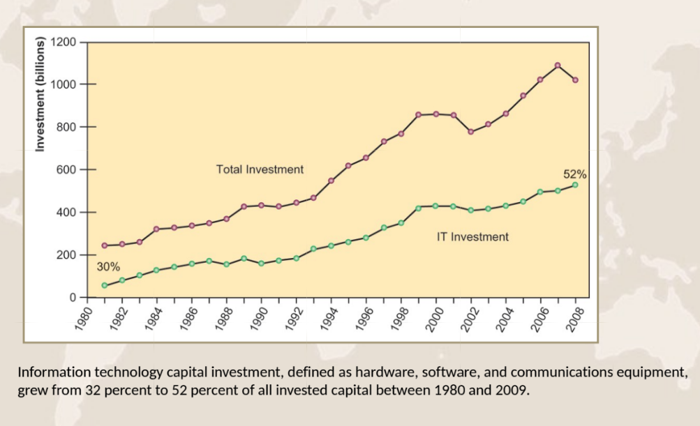
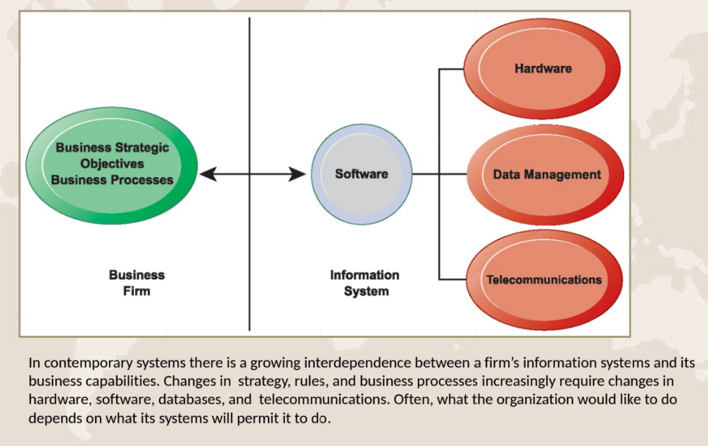

# جلسه اول

۱۴۰۵/۰۷/۱۵

## مقدمه

### منابع

- Management Information Systems: Managing the Digital Firm (12/c) (Kenneth C. Laudon, Jane P. Laudon, Prentice Hall, 2012)
- E. Turban, C. Pollard, G. Wood, Information Technology for Management, 12th Edition, Wiley, 2021
- سیستم های اطلاعاتی مدیریت، تالیف کنت لودون و جین لودون-ترجمه سید علی اکبر مصطفوی و سید مجتبی حسینی، انتشارات فدک ایساتیس
- سیستم های اطلاعاتی در مدیریت، تالیف دکتر سید محمد محمودی انتشارات دانشگاه تهران

### رئوس مطالب در طول ترم

- سیستم های اطلاعاتی در کسب و کار جهانی امروز
- کسب و کار الکترونیکی جهانی
- سیستمهای اطلاعاتی، سازمانها و استراتژی ها
- مسائل اخلاقی و اجتماعی در سیستمهای اطلاعاتی
- دستیابی به مزیت عملیاتی و رضایتمندی مشتریان
- تجارت الکترونیکی، بازارهای دیجیتالی و کالاهای دیجیتالی
- مدیریت دانش
- بهبود تصمیم گیری

### ارزشیابی دروس

- میان ترم: ۷ نمره (حذفی) - ۱۸ آذر
- پایان ترم: ۷ نمره
- پروژه: ۴ نمره (case study گروهی)
- فعالیت کلاسی: ۱ نمره
- حضور در کلاس و رعایت نظم و قوانین کلاس: ۱ نمره

راه ارتباطی با استاد:

sara.nodoust1988@gmail.com

## فصل ۱: سیستم‌های اطلاعاتی در کسب‌وکار جهانی امروز

صفحه ۳ فایل کتاب (نمونه بیسبال) مطالعه شود

### اهداف یادگیری

- چگونه سیستم‌های اطلاعاتی در حال متحول کردن کسب‌وکار هستند، و چرا برای اداره و مدیریت یک کسب‌وکار در دنیای امروز ضروری می‌باشند؟
- سیستم اطلاعاتی چیست؟ چگونه کار می‌کند؟ اجزای مدیریت، سازمان و فناوری آن کدامند؟ چرا دارایی‌های مکمل برای تضمین اینکه سیستم‌های اطلاعاتی ارزش واقعی برای سازمان‌ها ایجاد می‌کنند، ضروری هستند؟
- از چه رشته‌های دانشگاهی برای مطالعه سیستم‌های اطلاعاتی استفاده می‌شود و هر یک چه سهمی در درک سیستم‌های اطلاعاتی دارند؟

### نقش سیستم‌های اطلاعاتی در تحول کسب‌وکار

#### چگونه سیستم‌های اطلاعاتی در حال متحول کردن کسب‌وکار هستند

- ظهور پلتفرم دیجیتال موبایل
- رشد استفاده کسب‌وکارها از "کلان داده"
- رشد رایانش ابری

#### فرصت‌های جهانی‌سازی

- اینترنت به طور چشمگیری هزینه‌های عملیاتی را در مقیاس جهانی کاهش داده است
- افزایش تجارت خارجی، برون‌سپاری
- ارائه چالش‌ها و فرصت‌ها

#### در شرکت کاملاً دیجیتال نوظهور

- روابط تجاری مهم به صورت دیجیتالی فعال و واسطه‌گری می‌شوند.
- فرآیندهای اصلی کسب‌وکار به صورت دیجیتالی از طریق شبکه‌های دیجیتال انجام می‌شوند.
- دارایی‌های کلیدی شرکت به صورت دیجیتالی مدیریت می‌شوند.

#### شرکت‌های دیجیتال انعطاف‌پذیری بیشتری در سازمان و مدیریت ارائه می‌دهند

- جابجایی زمان، جابجایی مکان

#### وابستگی متقابل رو به رشد بین

- توانایی استفاده از فناوری اطلاعات و
- توانایی اجرای استراتژی‌های شرکت و دستیابی به اهداف شرکت

#### شرکت‌ها سرمایه‌گذاری سنگینی در سیستم‌های اطلاعاتی انجام می‌دهند تا به شش هدف استراتژیک تجاری دست یابند

۱. تعالی عملیاتی
۲. محصولات، خدمات و مدل‌های تجاری جدید
۳. صمیمیت با مشتری و تامین‌کننده
۴. بهبود تصمیم‌گیری
۵. مزیت رقابتی
۶. بقا

#### تعالی عملیاتی

- بهبود کارایی برای دستیابی به سوددهی بالاتر
- سیستم‌های اطلاعاتی، فناوری، ابزاری مهم در دستیابی به کارایی و بهره‌وری بیشتر
- سیستم Retail Link والمارت، تامین‌کنندگان را به فروشگاه‌ها متصل می‌کند تا سیستم بازپرسازی (تکمیل مجدد موجودی) برتر داشته باشند

#### محصولات، خدمات و مدل‌های تجاری جدید

##### مدل تجاری
- نحوه تولید، ارائه و فروش محصول یا خدمات توسط شرکت برای ایجاد ثروت را توصیف می‌کند

##### سیستم‌های اطلاعاتی و فناوری
- ابزاری عمده برای محصولات، خدمات و مدل‌های تجاری جدید

- مثال‌ها: آی‌پد اپل، سیستم‌عامل اندروید گوگل و نتفلیکس

#### صمیمیت با مشتری و تامین‌کننده

##### خدمات‌دهی به مشتریان
- خدمات‌دهی خوب به مشتریان منجر به بازگشت مشتریان می‌شود که درآمد و سود را افزایش می‌دهد.
- مثال: هتل‌های مجلل که از رایانه‌ها برای ردیابی ترجیحات مشتریان استفاده می‌کنند و برای نظارت و سفارشی‌سازی محیط به کار می‌روند

##### صمیمیت با تامین‌کنندگان
- صمیمیت با تامین‌کنندگان به آن‌ها اجازه می‌دهد تا ورودی‌های حیاتی را ارائه دهند که هزینه‌ها را کاهش می‌دهد.
- مثال: سیستم اطلاعاتی JCPenney که سوابق فروش را به تولیدکننده قراردادی متصل می‌کند

#### بهبود تصمیم‌گیری

##### بدون اطلاعات دقیق
- مدیران باید از پیش‌بینی‌ها، بهترین حدس‌ها و شانس استفاده کنند
- منجر به موارد زیر می‌شود:
  - تولید بیش از حد، تولید کمتر از حد
  - تخصیص نادرست منابع
  - زمان پاسخ‌دهی ضعیف

##### پیامدهای ضعیف
- هزینه‌ها را افزایش می‌دهد، مشتریان را از دست می‌دهد
- مثال: داشبورد دیجیتال مبتنی بر وب ورایزون برای ارائه داده‌های لحظه‌ای به مدیران در مورد شکایات مشتریان، عملکرد شبکه، قطعی خطوط و غیره

#### مزیت رقابتی

- ارائه عملکرد بهتر
- دریافت هزینه کمتر برای محصولات برتر
- پاسخگویی به مشتریان و تامین‌کنندگان در زمان واقعی
- مثال‌ها: اپل، والمارت، UPS

#### بقا

##### فناوری‌های اطلاعاتی به عنوان ضرورت کسب‌وکار
- تغییرات در سطح صنعت
- مثال: معرفی دستگاه‌های خودپرداز توسط سیتی‌بانک

##### مقررات دولتی که نیازمند نگهداری سوابق هستند
- مثال‌ها: قانون کنترل مواد سمی، قانون ساربینز-اکسلی
- قانون داد-فرانک