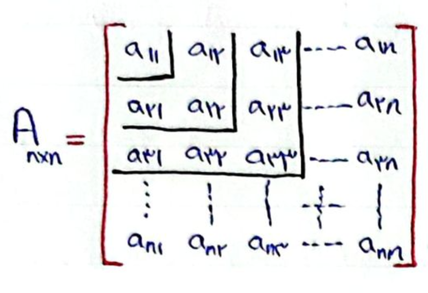

# جلسه پنجم

۱۴۰۵/۰۷/۲۲

## ادامه مثال‌های جلسه قبل

مثال: یک شرکت فروش کمپوت دارای دو کارخانه کمپوت‌سازی A و B می‌باشد. محصولات این دو کارخانه توسط ۳ نمایندگی M و N و O تأمین می‌شود. نمایندگی M مقدار ۲۵۰ کیلوگرم با قیمت هر کیلو ۴۰۰۰ تومان، N مقدار ۳۵۰ کیلوگرم با قیمت هر کیلو ۳۵۰۰ تومان و O مقدار ۴۰۰ کیلوگرم با قیمت هر کیلو ۳۰۰۰ تومان. هزینه حمل هر کیلو میوه از هر تعاونی مطابق جدول زیر است. ظرفیت تولید کارخانه‌های A و B به ترتیب ۴۵۰ و ۵۵۰ کیلوگرم است. هزینه تولید هر کیلو کمپوت در کارخانه‌های A و B به ترتیب ۲۵۰۰ و ۲۰۰۰ تومان می‌باشد. میوه‌های کمپوت شده از قرار هر کیلو ۷۰۰۰ تومان به فروش می‌رسد. شرکت می‌خواهد مشخص کند از هر تعاونی برای هر کارخانه چه مقدار میوه تهیه کند تا سود حداکثر شود.

| تعاونی / کارخانه | A | B |
|---|---|---|
| M | ۴۰ | ۵۰ |
| N | ۲۰ | ۳۰ |
| O | ۱۰۰ | ۶۰ |

ابتدا میزان سود را برای هر مسیر از کارخانه به نمایندگی محاسبه می‌کنیم.

$x_{ij}$: میزان محصولی که از کارخانه $i$ به نمایندگی $j$ فرستاده می‌شود.

$$
\begin{aligned}
M \to A &: 7000 - (2500 + 4000 + 40) = 460 \\
M \to B &: 7000 - (2000 + 4000 + 50) = 950 \\
N \to A &: 7000 - (2500 + 3500 + 20) = 980 \\
N \to B &: 7000 - (2000 + 3500 + 30) = 1470 \\
O \to A &: 7000 - (2500 + 3000 + 100) = 1400 \\
O \to B &: 7000 - (2000 + 3000 + 60) = 1940
\end{aligned}
$$

$$
\max : Z = 460x_{MA} + 950x_{MB} + 980x_{NA} + 1470x_{NB} + 1400x_{OA} + 1940x_{OB}
$$

$$
\text{حداکثر مقدار M و N و O}
\begin{cases}
x_{MA} + x_{MB} \le 250 \\
x_{NA} + x_{NB} \le 350 \\
x_{OA} + x_{OB} \le 400
\end{cases}
$$

$$
\text{ظرفیت تولید A و B}
\begin{cases}
x_{MA} + x_{NA} + x_{OA} \le 450 \\
x_{MB} + x_{NB} + x_{OB} \le 550
\end{cases}
$$

## بهینه‌سازی توابع چند متغیره

$$
f(x,y) = x^2 - 2y^2 + 5xy \\ \mathbb{R}^2 \mapsto \mathbb{R}
$$

در ساده‌ترین حالت فرض کنید یک تابع چند متغیره مانند $f(x_1, \dots, x_n)$ وجود دارد و هدف به‌دست آوردن $\max$ و $\min$ آن است.

### تعریف بردار گرادیان و ماتریس گرادیان ۲

تابع $f$ به صورت $f: S \mapsto \mathbb{R}$ را در نظر بگیرید به طوری که $S \subseteq \mathbb{R}^n$ است. در این صورت بردار گرادیان $f$ را به صورت زیر تعریف می‌کنیم:

$$
\nabla f(x) = \left( \frac{\partial f}{\partial x_1}, \frac{\partial f}{\partial x_2}, \dots, \frac{\partial f}{\partial x_n} \right)
$$

ماتریس گرادیان ۲ را به صورت $\nabla^2 f$ نشان داده و به صورت زیر نشان داده می‌شود:

$$
\nabla^2 f =
\begin{bmatrix}
\frac{\partial^2 f}{\partial x_1^2} & \frac{\partial^2 f}{\partial x_1 \partial x_2} & \cdots & \frac{\partial^2 f}{\partial x_1 \partial x_n} \\
\frac{\partial^2 f}{\partial x_2 \partial x_1} & \frac{\partial^2 f}{\partial x_2^2} & \cdots & \frac{\partial^2 f}{\partial x_2 \partial x_n} \\
\vdots & \vdots & \ddots & \vdots \\
\frac{\partial^2 f}{\partial x_n \partial x_1} & \frac{\partial^2 f}{\partial x_n \partial x_2} & \cdots & \frac{\partial^2 f}{\partial x_n^2}
\end{bmatrix}
$$

- نکته: ترتیب مشتق گرفتن نسبت به متغیرها تأثیری در جواب نهایی ندارد.

مثال: گرادیان و گرادیان ۲ تابع زیر را بدست آورید

$$
f(x_1, x_2, x_3) = x_1^3 + x_1 x_2 x_3 + x_2^3 + x_3^3
$$

$$
\nabla f = \left( 3x_1^2 + x_2 x_3, \; x_1 x_3 + 3x_2^2, \; x_1 x_2 + 3x_3^2 \right)
$$

$$
\nabla^2 f =
\begin{bmatrix}
6x_1 & x_3 & x_2 \\
x_3 & 6x_2 & x_1 \\
x_2 & x_1 & 6x_3
\end{bmatrix}
$$

تعریف: معین یا نامعین بودن ماتریس‌های مربع

به کلیه ماتریس‌های مربعی که با شروع از $a_11$ استخراج می‌شود، minor می‌گویند.

$$
\alpha_1 = a_{11}, \quad \alpha_2 = \begin{vmatrix} a_{11} & a_{12} \\ a_{21} & a_{22} \end{vmatrix}, \quad \dots, \quad \alpha_n = |A|
$$

۱. اگر $\alpha_i \ge 0$: ماتریس معین مثبت است
۲. اگر $\begin{cases} \alpha_{2k} \ge 0 \\ \alpha_{2k+1} < 0 \end{cases}$: ماتریس معین منفی است
۳. اگر هیچ کدام از حالت‌های بالا برقرار نباشد، ماتریس نامعین است

مثال: در مورد وضعیت معین یا نامعین بودن ماتریس‌های زیر اظهار نظر کنید

$$
A = \begin{bmatrix} 1 & 3 \\ 2 & 1 \end{bmatrix}
$$

$$
\alpha_1 = 1, \quad \alpha_2 = \begin{vmatrix} 1 & 3 \\ 2 & 1 \end{vmatrix} = 1 - 6 = -5
$$

ماتریس نامعین است.

$$
A = \begin{bmatrix} 4 & 0 & 2 \\ 0 & 1 & 0 \\ 2 & 0 & 4 \end{bmatrix}
$$

$$
\alpha_1 = 4, \quad \alpha_2 = \begin{vmatrix} 4 & 0 \\ 0 & 1 \end{vmatrix} = 4, \quad \alpha_3 = (4 \times 1 \times 4) - (2 \times 1 \times 2) = 12
$$

ماتریس معین مثبت است.

برای بدست آوردن نقاط بهینه تابع چند متغیره، ابتدا از تابع گرادیان گرفته و آن را برابر صفر قرار می‌دهیم، سپس با استفاده از ماتریس گرادیان ۲ و معین بودن آن، نوع نقطه (ماکسیمم، مینیمم یا زینی) را تعیین می‌کنیم.

### محاسبه نقاط بحرانی

برای به دست آوردن نقاط بهینه (اکسترمم) تابع چند متغیره $\nabla f = 0$ قرار داده می‌شود تا نقاط بحرانی محاسبه شود. اگر $\nabla^2 f(\bar{x})$ یک ماتریس معین مثبت باشد، $\bar{x}$ یک نقطه $\min$ است؛ اگر $\nabla^2 f(\bar{x})$ یک ماتریس معین منفی باشد، $\bar{x}$ یک نقطه $\max$ است؛ اگر $\nabla^2 f(\bar{x})$ یک ماتریس نامعین باشد، آنگاه $\bar{x}$ نقطه عطف است.