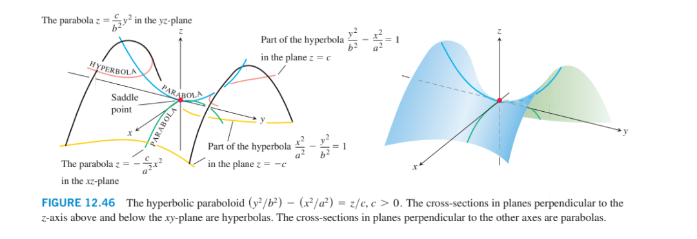
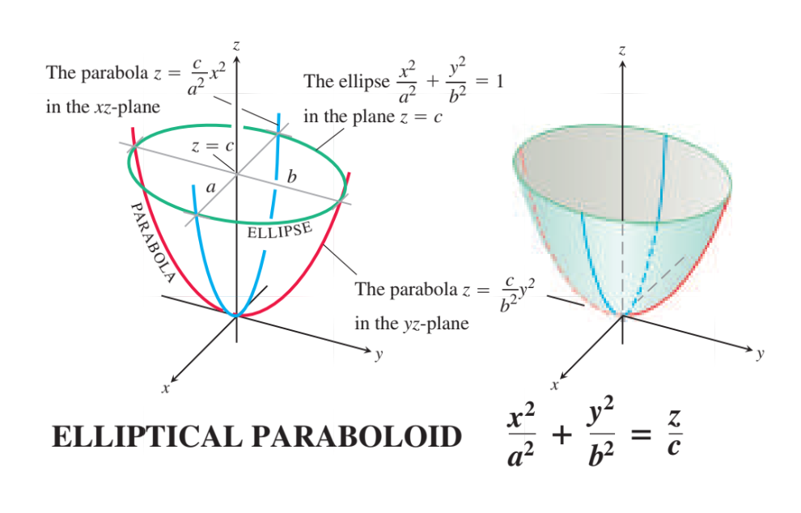
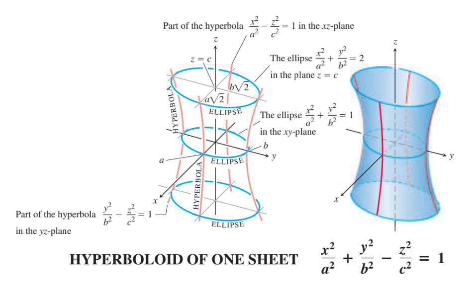
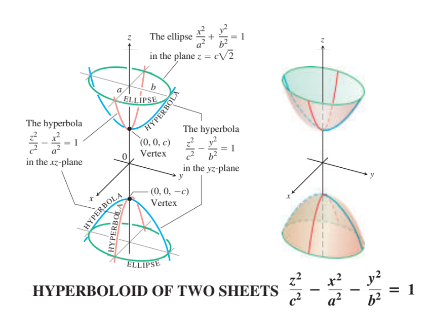
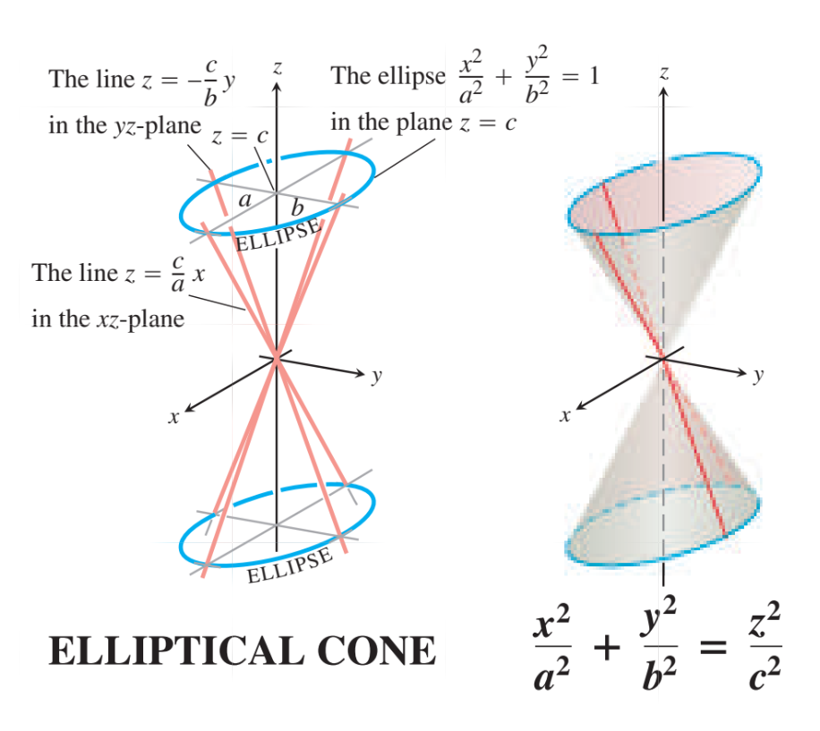

# جلسه پنجم

۱۴۰۵/۰۷/۱۸

## تمرینات حل شده اول کلاس

- مثال ۹ بخش ۱۲.۵
- تمرین ۹ بخش ۱۲.۵

## رویه‌های درجه دوم

### کره

معادله کره به مرکز $C(c_1, c_2, c_3)$ و شعاع $r$

$$
(x - c_1)^2 + (y - c_2)^2 + (z - c_3)^2 = r^2
$$

معنی هندسی کره، مکان هندسی نقاطی است که فاصله‌ی آنها از یک نقطه ثابت برابر $r$ است.

### بیضیگون (ellipsoid)

$$
\frac{(x - x_0)^2}{a^2} + \frac{(y - y_0)^2}{b^2} + \frac{(z - z_0)^2}{c^2} = 1
$$

### بیضی

$$
|PF_1| + |PF_2| = 2a
$$

$$
\frac{x^2}{a^2} + \frac{y^2}{b^2} = 1
$$

### استوانه مستدیر

$$
x^2 + y^2 = a^2, \quad z \in \mathbb{R}
$$

### سهمیگون هذلولوی (hyperbolic paraboloid)

$$
\pm \frac{x^2}{a^2} \mp \frac{y^2}{b^2} = \frac{z}{c}
$$

$$
x = 0 \implies \mp \frac{y^2}{b^2} = \frac{z}{c} \implies z = \mp \frac{c}{b^2} y^2
$$

$$
y = 0 \implies \pm \frac{x^2}{a^2} = \frac{z}{c} \implies z = \pm \frac{c}{a^2} x^2
$$

$$
z = \text{const} \implies \text{hyperbola}
$$

$$
x = \text{const}\quad\text{یا}\quad y = \text{const} \implies \text{parabola}
$$

### سهمیوار بیضوی (elliptical paraboloid)

$$
+\frac{x^2}{a^2} + \frac{y^2}{b^2} = \frac{z}{c}
$$

### هذلولیگون یکپارچه (hyperboloid of one sheet)

$$
+\frac{x^2}{a^2} +\frac{y^2}{b^2} -\frac{z^2}{c^2} = 1
$$

### هذلولیگون دوپارچه (hyperboloid of two sheets)

$$
+\frac{x^2}{a^2} -\frac{y^2}{b^2} -\frac{z^2}{c^2} = 1
$$

$$
x > a \quad \text{or} \quad x < -a
$$

$$
-a < x < a \quad \frac{x^2}{a^2} < 1 \implies 1 - \frac{x^2}{a^2} > 0
$$

### مخروط

$$
+\frac{x^2}{a^2} + \frac{y^2}{b^2} = \frac{z^2}{c^2}
$$

---

حل تمرینات ۱۲.۶