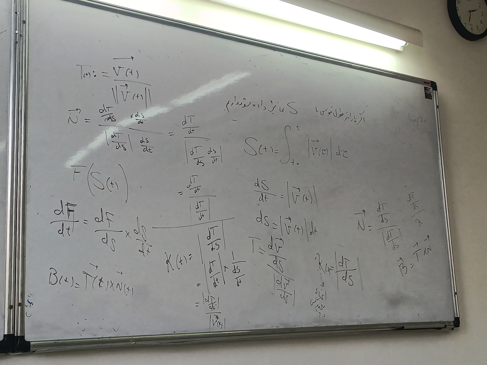

# جلسه هفتم

۱۴۰۵/۰۷/۲۵

## ادامه فصل ۱۳

مثال جلسه قبل:

مثال: پرتابه، در صفحه دو بعدی. $r_0$ و $v_0$ داده شده، حرکت تحت شتاب گرانش $-g$ است. زمان و مکان نقطه اوج پرتاب و زمان و مکان فرود را پیدا کنید.

$$
\vec{v}_0 = (|\vec{v}_0|\cos\theta, |\vec{v}_0|\sin\theta) \quad \vec{a} = (0,-g)
$$

$$
\vec{v}(t) = \int \vec{a}(t) dt = \left( \int 0 dt, \int -g dt \right) = (C_1, -gt + C_2)
$$

$$
\vec{v}(0) = \vec{v}_0 \quad \vec{v}(t) = (|\vec{v}_0|\cos\theta, -gt + |\vec{v}_0|\sin\theta)
$$

$$
\vec{v}(0) = (C_1, C_2) = \vec{v}_0 \implies C_1 = |\vec{v}_0|\cos\theta, \quad C_2 = |\vec{v}_0|\sin\theta
$$

$$
\vec{r}(t) = \int \vec{v}(t) dt = \left( |\vec{v}_0|\cos\theta \cdot t + C_1, |\vec{v}_0|\sin\theta \cdot t - \frac{1}{2}gt^2 + C_2 \right)
$$

$$
\vec{r}(0) = (0,0)
$$

$$
\vec{r}(t) = \left( |\vec{v}_0|\cos\theta \cdot t, |\vec{v}_0|\sin\theta \cdot t - \frac{1}{2}gt^2 \right)
$$

$$
y_{max}: V_y = 0 \implies |\vec{v}_0|\sin\theta - gt = 0 \implies \boxed{t = \frac{|\vec{v}_0|\sin\theta}{g}}
$$

$$
\to y_{max} = y\left(\frac{|\vec{v}_0|\sin\theta}{g}\right)
$$

$$
x_d = \frac{2|\vec{v}_0|^2\cos\theta\sin\theta}{g} = \frac{|\vec{v}_0|^2\sin 2\theta}{g}
$$

---

### دستگاه TNB (کنج فرنه)

سه نوع دستگاه داریم.

فرض کنیم مکان حرکت متحرک با $\vec{r}(t)$ نمایش داده شود. آنگاه اگر سرعت متحرک صفر نباشد و اندازه آن با ثابت ۱ برابر باشد، آنگاه گوییم $\vec{r}(t)$ بر حسب طول قوس پارامتری شده است.

$$
\|\vec{v}(t)\| = 1 \implies \langle \vec{v}(t), \vec{v}(t) \rangle = 1
$$

بردار مماس یکه ($\mathbf{T}$) به صورت زیر تعریف می‌شود:
$$
\mathbf{T}(t) = \frac{\vec{v}(t)}{\|\vec{v}(t)\|}
$$

اگر پارامتر طول قوس با $S$ نمایش داده شود، داریم:
$$
S(t) = \int_{t_0}^{t} |\vec{v}(\tau)| d\tau
$$
$$
\frac{dS}{dt} = |\vec{v}(t)|
$$
$$
dS = |\vec{v}(t)| dt
$$

بنابراین بردار مماس یکه بر حسب طول قوس برابر است با:
$$
\vec{T} = \frac{d\vec{r}}{dS} = \frac{\frac{d\vec{r}}{dt}}{\frac{dS}{dt}} = \frac{\vec{v}}{|\vec{v}|}
$$

#### انحنا (Curvature)

$$
\kappa(t) = \left| \frac{d\vec{T}}{dS} \right| = \frac{\left| \frac{d\vec{T}}{dt} \right|}{\left| \frac{dS}{dt} \right|} = \frac{\left| \frac{d\vec{T}}{dt} \right|}{|\vec{v}(t)|}
$$

#### بردار نرمال یکه ($\vec{N}$)

با استفاده از قاعده زنجیره‌ای $\left( \frac{d\vec{T}}{dt} = \frac{d\vec{T}}{dS} \cdot \frac{dS}{dt} \right)$ داریم:
$$
\vec{N} = \frac{\frac{d\vec{T}}{dS}}{\left| \frac{d\vec{T}}{dS} \right|} = \frac{\frac{d\vec{T}}{dt} \cdot \frac{dt}{dS}}{\left| \frac{d\vec{T}}{dt} \cdot \frac{dt}{dS} \right|} = \frac{\frac{d\vec{T}}{dt}}{\left| \frac{d\vec{T}}{dt} \right|}
$$

$$
\vec{N} = \frac{\frac{d\vec{T}}{dS}}{\kappa}
$$

#### بردار دوجنبه یا باینرمال ($\vec{B}$)
$$
\vec{B} = \vec{T} \times \vec{N}
$$

---

مطالب بالا

---

مثال: فرض کنید یک متحرک بر دایره‌ای با معادله حرکت $\vec{r}(t) = (\cos t, \sin t)$ حرکت کند. کنج فرنه و انحنای متحرک را در هر لحظه بیابید.

- حل:

$$
\vec{v}(t) = \frac{d\vec{r}}{dt} = (-\sin t, \cos t) \implies |\vec{v}(t)| = \sqrt{(-\sin t)^2 + \cos^2 t} = 1
$$

$$
\vec{T}(t) = \frac{\vec{v}(t)}{|\vec{v}(t)|} = (-\sin t, \cos t)
$$

$$
\frac{d\vec{T}}{dt} = (-\cos t, -\sin t) \quad , \quad | \frac{d\vec{T}}{dt} | = 1
$$

$$
\vec{N} = \frac{\frac{d\vec{T}}{dt}}{| \frac{d\vec{T}}{dt} |} = (-\cos t, -\sin t)
$$

---

$$
\vec{B}(t) = \vec{T}(t) \times \vec{N}(t) = \begin{vmatrix} \hat{i} & \hat{j} & \hat{k} \\ -\sin t & \cos t & 0 \\ -\cos t & -\sin t & 0 \end{vmatrix}
$$

$$
= (\sin^2 t + \cos^2 t)\hat{k} = \hat{k}
$$

---

$$
\kappa(t) = \left| \frac{d\vec{T}}{dS} \right| = \frac{\left| \frac{d\vec{T}}{dt} \right|}{|\vec{v}(t)|} = \frac{1}{1} = 1
$$

---

معادله دایره انحنا

$$
\vec{r}_c = \vec{r}(t) + \frac{1}{\kappa(t)} \vec{N}(t)
$$

$$
(x - x_c)^2 + (y - y_c)^2 = \left( \frac{1}{\kappa} \right)^2
$$

---

تمرین: ثابت کنید

$$\kappa(t) = \frac{|\vec{v}(t) \times \vec{a}(t)|}{|\vec{v}(t)|^3}$$

### تاب خوردگی یا میزان خروج از صفحه بوسان

$$
\vec{B} = \vec{T} \times \vec{N}
$$

تاب ذره با معادله $\vec{r}(t)$ را با $\tau(t)$ نمایش می‌دهیم و تعریف می‌کنیم:

$$
\tau(s) = \left| \frac{d\vec{B}(s)}{ds} \right|
$$

$$
\tau = \frac{\det \begin{pmatrix} \vec{r}'(t) \\ \vec{r}''(t) \\ \vec{r}'''(t) \end{pmatrix}}{|\vec{v} \times \vec{a}|^2}
$$

---

مثال: کنج فرنه، انحنا و تاب مارپیچ (فنر) را بیابید.

$$
\vec{r}(t) = (a\cos t, a\sin t, bt)
$$