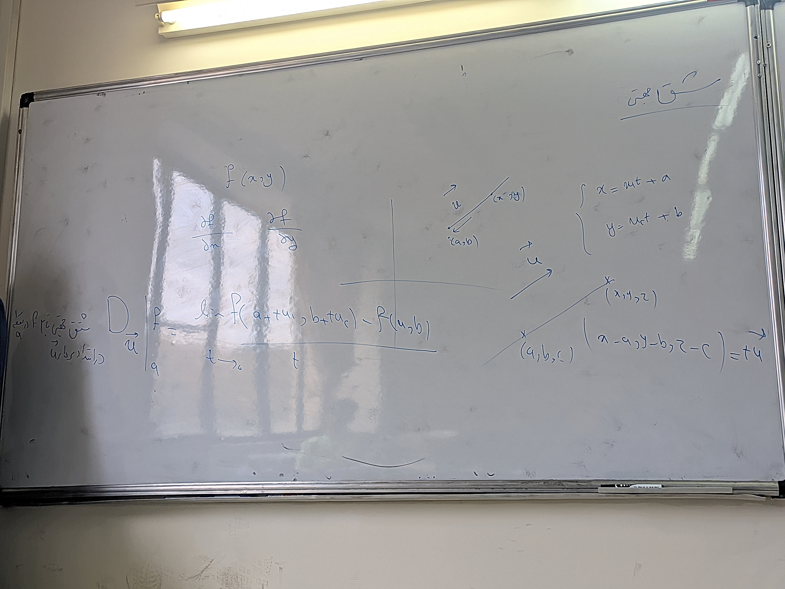

# جلسه سیزدهم

۱۴۰۵/۰۸/۱۶

## ادامه فصل ۱۴

$$
\frac{d}{dx} \int_{u(x)}^{v(x)} f(t) dt = v'(x) f(v(x)) - u'(x) f(u(x))
$$

$$
= \frac{d}{dx} \left( \int_{a}^{v(x)} f(t) dt - \int_{a}^{u(x)} f(t) dt \right)
$$

$$
F(v(x)) = \int_{a}^{v(x)} f(t) dt \implies \frac{d}{dx} F(v(x)) = v'(x) F'(v(x)) = v'(x) f(v(x))
$$

$$
\frac{d}{dx} \int_{a}^{b} g(x,t) dt = \int_{a}^{b} g_x(x,t) dt
$$

---

$$
\lim_{x \to x_0} f(g(x)) = f\left(\lim_{x \to x_0} g(x)\right)
$$

قضیه اول انتگرال

$$
F(x) = \int_{a}^{x} f(t) dt
$$

$$
\frac{d}{dx} F(x) = F'(x) \implies F'(x) = f(x)
$$

---

### مشتق جهتی

توابع چند متغیره

$$
f(x, y)
$$

$$
\frac{\partial f}{\partial x} \quad \frac{\partial f}{\partial y}
$$

$$
D_{\vec{u}}f \bigg|_a = \lim_{t \to 0} \frac{f(a + t u_1, b + t u_2) - f(a,b)}{t}
$$

$$
\begin{cases} x = u_1 t + a \\ y = u_2 t + b \end{cases}
$$

$$ (x, y, z) \quad (a,b,c) $$

$$
(x-a, y-b, z-c) = t\vec{u}
$$

---

 مثال: $f(x,y) = x^2 + xy$

$$
P(1, 2)
$$

$$
\vec{u} = \frac{1}{\sqrt{2}}\vec{i} + \frac{1}{\sqrt{2}}\vec{j}
$$

$$
D_{\vec{u}} f \bigg|_P = \lim_{t \to 0} \frac{f\left(1 + \frac{t}{\sqrt{2}}, 2 + \frac{t}{\sqrt{2}}\right) - f(1,2)}{t}
$$

$$
= \lim_{t \to 0} \frac{\left(1 + \frac{t}{\sqrt{2}}\right)^2 + \left(1 + \frac{t}{\sqrt{2}}\right)\left(2 + \frac{t}{\sqrt{2}}\right) - 3}{t}
$$

$$
= \lim_{t \to 0} \frac{1 + \frac{2t}{\sqrt{2}} + \frac{t^2}{2} + 2 + \frac{3t}{\sqrt{2}} + \frac{t^2}{2} - 3}{t}
$$

$$
= \lim_{t \to 0} \frac{\frac{5t}{\sqrt{2}} + t^2}{t} = \frac{5}{\sqrt{2}}
$$

### گرادیان

$$
F: \mathbb{R}^2 \to \mathbb{R}
$$

$$
\nabla f = \left( \frac{\partial f}{\partial x}, \frac{\partial f}{\partial y} \right)
$$

مثال: $f(x,y) = x^2 + xy$

$$
\nabla f = (2x + y, x)
$$

#### خواص گرادیان

۱. $$
\nabla(kf) = k\nabla f
$$

۲. $$
\nabla(f \pm g) = \nabla f \pm \nabla g
$$

۳. $$
\nabla(fg) = (\nabla f)g + f(\nabla g)
$$

۴. $$
\frac{(\nabla f)g - f(\nabla g)}{g^2} = \nabla\left(\frac{f}{g}\right)
$$

---

قضیه: اگر $f$ یک تابع مشتق‌پذیر با مشتقات جزئی پیوسته در همسایگی شامل $(a,b)$ باشد، آنگاه:

$$
D_{\vec{u}} f \bigg|_{(a,b)} = \langle (\nabla f)(a,b), \vec{u} \rangle
$$

---

تعمیم:

$$
F: \mathbb{R}^n \to \mathbb{R}
$$

$$
F(x_1, \dots, x_n)
$$

$$
\nabla F = \left( \frac{\partial F}{\partial x_1}, \dots, \frac{\partial F}{\partial x_n} \right)
$$

$$
D_{\vec{u}} F \bigg|_{(a,b)} = \langle (\nabla F)(a,b), \vec{u} \rangle
$$

---

با استفاده از قضیه فوق، مقدار مشتق جهتی تابع $f$ در جهات زیر بدین صورت است:

۱) جهت $\vec{u}$ عمود بر $\nabla f$ باشد، آنگاه $D_{\vec{u}} f|_P = 0$
$$
D_{\vec{u}} f|_P = \langle \vec{u}, \nabla f \rangle = 0
$$

۲) اگر جهت $\vec{u}$ در جهت $\nabla f$ باشد، مشتق جهتی ماکسیمم مقدار خود را دارد:
$$
D_{\vec{u}} f|_P = |\vec{u}| |\nabla f| \cos\theta
$$
(بیشترین مقدار وقتی $\theta = 0$ است)

۳) جهت $\vec{u}$ در خلاف جهت $\nabla f$ باشد، مشتق جهتی مینیمم است.

---

$$
z = f(x,y)
$$

$$
\frac{d}{dt} f(\vec{r}(t)) = \langle \nabla f, \vec{r}'(t) \rangle
$$

---

تمرین ۲۵

صورت سوال:
خطوط مماس بر منحنی‌های تراز (Tangent Lines to Level Curves)، منحنی $f(x,y) = c$ را همراه با $\nabla f$ و خط مماس در نقطه داده شده رسم کنید. سپس معادله‌ای برای خط مماس بنویسید.

۲۵. $x^2 + y^2 = 4$ ، نقطه $(\sqrt{2}, \sqrt{2})$

---

حل:

تابع را به صورت $f(x,y) = x^2 + y^2$ در نظر می‌گیریم که منحنی تراز آن برابر با $4$ است.

۱. محاسبه بردار گرادیان:
$$
\nabla f = \left( \frac{\partial f}{\partial x}, \frac{\partial f}{\partial y} \right) = (2x, 2y)
$$

۲. مقدار گرادیان در نقطه داده شده:
$$
\nabla f(\sqrt{2}, \sqrt{2}) = (2\sqrt{2}, 2\sqrt{2})
$$

---

صورت سوال: خط مماس بر منحنی تراز $x^2 + y^2 = 4$ در نقطه $(\sqrt{2}, \sqrt{2})$ را بیابید.

۳. معادله خط مماس با استفاده از ضرب داخلی بردارها:
می‌دانیم بردار مماس بر منحنی تراز عمود بر بردار گرادیان است. بنابراین ضرب داخلی بردار واقع بر خط مماس و بردار گرادیان برابر صفر است:

$$
\langle (x - \sqrt{2}, y - \sqrt{2}), \nabla f(\sqrt{2}, \sqrt{2}) \rangle = 0
$$

با جایگذاری بردار گرادیان:

$$
\langle (x - \sqrt{2}, y - \sqrt{2}), (2\sqrt{2}, 2\sqrt{2}) \rangle = 0
$$

۴. بسط دادن معادله:

$$
2\sqrt{2}(x - \sqrt{2}) + 2\sqrt{2}(y - \sqrt{2}) = 0
$$

۵. ساده‌سازی و یافتن معادله نهایی:
با تقسیم طرفین بر $2\sqrt{2}$:

$$
x - \sqrt{2} + y - \sqrt{2} = 0
$$

$$
x + y = 2\sqrt{2}
$$

---

صورت سوال:
مشتق تابع $f(x, y, z)$ در نقطه $P$ در جهت بردار $\mathbf{v} = \mathbf{i} + \mathbf{j} - \mathbf{k}$ بیشترین مقدار خود را دارد. در این جهت، مقدار مشتق برابر $2\sqrt{3}$ است.
الف) $\nabla f$ در نقطه $P$ چیست؟ دلایل خود را بنویسید.
ب) مشتق تابع $f$ در نقطه $P$ در جهت بردار $\mathbf{i} + \mathbf{j}$ چقدر است؟

---

حل:

الف) می‌دانیم که مشتق جهتی یک تابع در نقطه‌ای، در جهت بردار گرادیان ($\nabla f$) بیشترین مقدار خود را دارد. همچنین، بیشترین مقدار مشتق جهتی برابر با اندازه بردار گرادیان ($|\nabla f|$) است.

بنابراین، بردار $\nabla f$ در نقطه $P$ هم‌جهت با بردار $\mathbf{v}$ است و اندازه آن برابر $2\sqrt{3}$ می‌باشد:
$$
|\nabla f| = 2\sqrt{3}
$$

بردار یکه در جهت $\mathbf{v}$ را به دست می‌آوریم:
$$
|\mathbf{v}| = \sqrt{1^2 + 1^2 + (-1)^2} = \sqrt{3}
$$
$$
\mathbf{u} = \frac{\mathbf{v}}{|\mathbf{v}|} = \frac{1}{\sqrt{3}}\mathbf{i} + \frac{1}{\sqrt{3}}\mathbf{j} - \frac{1}{\sqrt{3}}\mathbf{k}
$$

از آنجا که $\nabla f$ هم‌جهت با $\mathbf{v}$ است، می‌توانیم بنویسیم:
$$
\nabla f = |\nabla f| \cdot \mathbf{u} = 2\sqrt{3} \left( \frac{1}{\sqrt{3}}\mathbf{i} + \frac{1}{\sqrt{3}}\mathbf{j} - \frac{1}{\sqrt{3}}\mathbf{k} \right)
$$
$$
\nabla f = 2\mathbf{i} + 2\mathbf{j} - 2\mathbf{k}
$$

ب) برای یافتن مشتق تابع در جهت بردار $\mathbf{w} = \mathbf{i} + \mathbf{j}$، ابتدا باید بردار یکه در این جهت را پیدا کنیم:
$$
|\mathbf{w}| = \sqrt{1^2 + 1^2} = \sqrt{2}
$$
$$
\mathbf{u}_w = \frac{\mathbf{w}}{|\mathbf{w}|} = \frac{1}{\sqrt{2}}\mathbf{i} + \frac{1}{\sqrt{2}}\mathbf{j}
$$

مشتق جهتی برابر است با ضرب داخلی گرادیان در بردار یکه جهت:
$$
D_{\mathbf{u}_w} f = \nabla f \cdot \mathbf{u}_w = (2\mathbf{i} + 2\mathbf{j} - 2\mathbf{k}) \cdot \left( \frac{1}{\sqrt{2}}\mathbf{i} + \frac{1}{\sqrt{2}}\mathbf{j} \right)
$$
$$
D_{\mathbf{u}_w} f = (2)\left(\frac{1}{\sqrt{2}}\right) + (2)\left(\frac{1}{\sqrt{2}}\right) + (-2)(0) = \frac{2}{\sqrt{2}} + \frac{2}{\sqrt{2}} = \frac{4}{\sqrt{2}} = 2\sqrt{2}
$$