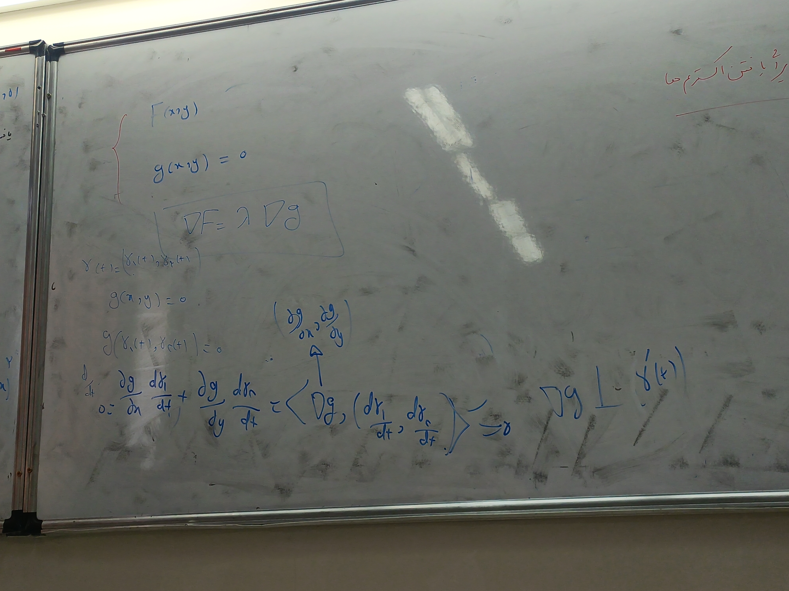

# جلسه شانزدهم

۱۴۰۵/۰۸/۲۶

## ادامه فصل ۱۴

### یافتن ماکسیمم و مینیمم توابع دو متغیره بر یک ناحیه محدود

مثال ۶: مقادیر ماکسیمم و مینیمم مطلق تابع زیر را روی ناحیه مثلثی در ربع اول که به خطوط $x=0$، $y=0$ و $y=9-x$ محدود شده است، بیابید:
$$
f(x,y) = 2 + 2x + 4y - x^2 - y^2
$$

---

حل:

تابع مشتق‌پذیر است، بنابراین مقادیر اکسترمم مطلق فقط در نقاط داخلی (که $f_x = f_y = 0$ هستند) یا روی مرزهای مثلث رخ می‌دهند.

**(الف) نقاط داخلی:**
$$
f_x = 2 - 2x = 0 \implies x = 1
$$
$$
f_y = 4 - 2y = 0 \implies y = 2
$$
نقطه $(1,2)$ در داخل مثلث قرار دارد. مقدار تابع در این نقطه:
$$
f(1,2) = 2 + 2(1) + 4(2) - (1)^2 - (2)^2 = 2 + 2 + 8 - 1 - 4 = 7
$$

**(ب) نقاط روی مرزها:**

۱. روی پاره‌خط $OA$ که $y=0$ است (برای $0 \leq x \leq 9$):
$$
f(x,0) = 2 + 2x - x^2
$$
مشتق آن: $f' = 2 - 2x = 0 \implies x=1$.
مقادیر تابع در نقاط بحرانی و دو سر بازه:
$$
f(0,0) = 2
$$
$$
f(1,0) = 3
$$
$$
f(9,0) = 2 + 18 - 81 = -61
$$

۲. روی پاره‌خط $OB$ که $x=0$ است (برای $0 \leq y \leq 9$):
$$
f(0,y) = 2 + 4y - y^2
$$
مشتق آن: $f' = 4 - 2y = 0 \implies y=2$.
مقادیر تابع:
$$
f(0,0) = 2
$$
$$
f(0,2) = 6
$$
$$
f(0,9) = 2 + 36 - 81 = -43
$$

۳. روی پاره‌خط $AB$ که $y = 9-x$ است (برای $0 \leq x \leq 9$):
تابع را بر حسب $x$ می‌نویسیم:
$$
f(x, 9-x) = 2 + 2x + 4(9-x) - x^2 - (9-x)^2
$$
$$
= 2 + 2x + 36 - 4x - x^2 - (81 - 18x + x^2)
$$
$$
= -43 + 16x - 2x^2
$$
مشتق آن: $f' = 16 - 4x = 0 \implies x=4$.
اگر $x=4$ باشد، $y = 9-4 = 5$. مقدار تابع:
$$
f(4,5) = -43 + 16(4) - 2(16) = -43 + 64 - 32 = -11
$$

**(ج) جمع‌بندی مقادیر:**
لیست تمام مقادیر به دست آمده: $7, 2, 3, -61, 6, -43, -11$

- ماکسیمم مطلق: **$7$** که در نقطه $(1,2)$ رخ می‌دهد.
- مینیمم مطلق: **$-61$** که در نقطه $(9,0)$ رخ می‌دهد.

---

### روش ضرایب لاگرانژ برای یافتن اکسترمم‌ها

---

مثال: نقاط بر استوانه هذلولوی $x^2 - z^2 = 1$ را به گونه‌ای بیابید که نزدیک‌ترین به مبدأ باشند.

---

مثال ۲: نقاط روی استوانه هذلولوی $x^2 - z^2 - 1 = 0$ را بیابید که نزدیک‌ترین فاصله را به مبدأ دارند.

---

حل ۱ (روش حذف متغیر):
ما به دنبال نقاطی روی استوانه هستیم که مقدار تابع زیر را کمینه کنند (که همان مجذور فاصله از مبدأ است):
$$
f(x,y,z) = x^2 + y^2 + z^2
$$
با شرط محدودکننده:
$$
x^2 - z^2 - 1 = 0
$$
اگر $x$ و $y$ را به عنوان متغیرهای مستقل در نظر بگیریم، از معادله شرط داریم $z^2 = x^2 - 1$. با جایگذاری این رابطه در تابع فاصله، تابع جدیدی بر حسب $x$ و $y$ به دست می‌آوریم:
$$
h(x,y) = x^2 + y^2 + (x^2 - 1) = 2x^2 + y^2 - 1
$$
برای یافتن نقاط اکسترمم $h$، مشتقات جزئی آن را صفر قرار می‌دهیم:
$$
h_x = 4x = 0 \quad \text{و} \quad h_y = 2y = 0
$$
که تنها جواب آن نقطه $(0,0)$ است. اما روی استوانه هیچ نقطه‌ای وجود ندارد که هم $x=0$ و هم $y=0$ باشد. مشکل کجاست؟
مشکل اینجاست که دامنه تابع $h$ کل صفحه $xy$ است، اما دامنه‌ای که مختصات $x$ و $y$ نقاط روی استوانه از آن انتخاب می‌شوند، به دلیل $z^2 = x^2 - 1 \geq 0$، به نوارهای $x \geq 1$ و $x \leq -1$ محدود می‌شود (داخل نوار $-1 < x < 1$ مجاز نیست).
اگر $y$ و $z$ را به عنوان متغیرهای مستقل انتخاب کنیم و $x$ را بر حسب آن‌ها بنویسیم ($x^2 = z^2 + 1$)، تابع فاصله به شکل زیر در می‌آید:
$$
k(y,z) = (z^2 + 1) + y^2 + z^2 = 1 + y^2 + 2z^2
$$
حالا نقاط کمینه‌کننده $k$ را می‌یابیم:
$$
k_y = 2y = 0 \quad \text{و} \quad k_z = 4z = 0 \implies y = z = 0
$$
با قرار دادن $y=0$ و $z=0$ در رابطه $x^2 = z^2 + 1$ داریم:
$$
x^2 = 1 \implies x = \pm 1
$$
بنابراین نقاط روی استوانه که کمترین فاصله را به مبدأ دارند، نقاط $(\pm 1, 0, 0)$ هستند.

---

حل ۲ (روش ضرایب لاگرانژ):
تصور کنید یک کره کوچک به مرکز مبدأ مانند یک حباب صابون منبسط می‌شود تا اینکه استوانه را لمس کند. در هر نقطه تماس، کره و استوانه صفحه مماس و خط عمود یکسانی دارند. بنابراین اگر کره و استوانه را به عنوان رویه‌های تراز توابع زیر در نظر بگیریم:
$$
f(x,y,z) = x^2 + y^2 + z^2 - a^2 = 0
$$
$$
g(x,y,z) = x^2 - z^2 - 1 = 0
$$
گرادیان‌های آن‌ها ($\nabla f$ و $\nabla g$) در نقاط تماس موازی خواهند بود. بنابراین باید اسکالری مانند $\lambda$ وجود داشته باشد که:
$$
\nabla f = \lambda \nabla g
$$
یا:
$$
2x\mathbf{i} + 2y\mathbf{j} + 2z\mathbf{k} = \lambda(2x\mathbf{i} - 2z\mathbf{k})
$$
بنابراین مختصات هر نقطه تماس باید در معادلات زیر صدق کند:
$$
2x = 2\lambda x, \quad 2y = 0, \quad 2z = -2\lambda z
$$
از آنجا که هیچ نقطه‌ای روی استوانه $x^2 - z^2 - 1 = 0$ دارای مختصات $x=0$ نیست، پس $x \neq 0$. در نتیجه از معادله اول $2x = 2\lambda x$ نتیجه می‌شود که $\lambda = 1$.
با جایگذاری $\lambda = 1$ در معادله سوم ($2z = -2\lambda z$)، به $2z = -2z$ می‌رسیم که تنها در صورتی برقرار است که $z=0$ باشد.
از معادله دوم نیز $y=0$ به دست آمد. پس تمام نقاط مورد نظر ما به شکل $(x, 0, 0)$ هستند.
کدام نقاط روی سطح $x^2 - z^2 = 1$ این شکل را دارند؟ با قرار دادن $z=0$ داریم:
$$
x^2 - 0 = 1 \implies x = \pm 1
$$
نقاط روی استوانه که نزدیک‌ترین فاصله را به مبدأ دارند، نقاط $(\pm 1, 0, 0)$ هستند.

---

elyasi82@khu.ac.ir

---

$$
F(x,y,z)
$$

$$
g_1(x,y,z) = 0
$$

$$
g_2(x,y,z) = 0
$$

$$
\nabla F = \lambda_1 \nabla g_1 + \lambda_2 \nabla g_2
$$

---

مثال ۵: صفحه $x + y + z = 1$ استوانه $x^2 + y^2 = 1$ را در یک بیضی قطع می‌کند. نقاطی روی این بیضی را بیابید که نزدیک‌ترین و دورترین فاصله را به مبدأ دارند.

---

حل:
می‌خواهیم اکسترمم‌های تابع فاصله (مجذور فاصله) را بیابیم:
$$
f(x,y,z) = x^2 + y^2 + z^2
$$
با دو شرط محدودکننده:
$$
g_1(x,y,z) = x^2 + y^2 - 1 = 0
$$
$$
g_2(x,y,z) = x + y + z - 1 = 0
$$

معادله گرادیان ($\nabla f = \lambda_1 \nabla g_1 + \lambda_2 \nabla g_2$) را می‌نویسیم:
$$
2x\mathbf{i} + 2y\mathbf{j} + 2z\mathbf{k} = \lambda_1(2x\mathbf{i} + 2y\mathbf{j}) + \lambda_2(\mathbf{i} + \mathbf{j} + \mathbf{k})
$$
با برابر قرار دادن مؤلفه‌ها، سه معادله زیر به دست می‌آید:
$$
2x = 2\lambda_1 x + \lambda_2
$$
$$
2y = 2\lambda_1 y + \lambda_2
$$
$$
2z = \lambda_2
$$
از معادله سوم $\lambda_2 = 2z$ است. با جایگذاری آن در دو معادله اول:
$$
2x = 2\lambda_1 x + 2z \implies (1 - \lambda_1)x = z
$$
$$
2y = 2\lambda_1 y + 2z \implies (1 - \lambda_1)y = z
$$
این معادلات همزمان برقرارند اگر یا $\lambda_1 = 1$ و $z = 0$ باشد، یا $\lambda_1 \neq 1$ و $x = y = \frac{z}{1 - \lambda_1}$ باشد.

**حالت اول: $z = 0$**
با قرار دادن $z = 0$ در معادلات شرط ($g_1$ و $g_2$):
$$
x^2 + y^2 = 1
$$
$$
x + y = 1
$$
با حل این دستگاه، به دو نقطه $(1, 0, 0)$ و $(0, 1, 0)$ می‌رسیم. این دو نقطه روی بیضی هستند و همان‌طور که در شکل ۱۴.۵۹ مشخص است، نزدیک‌ترین نقاط به مبدأ می‌باشند.

**حالت دوم: $x = y$**
اگر $x = y$ باشد، با قرار دادن در معادلات شرط:
$$
x^2 + x^2 = 1 \implies 2x^2 = 1 \implies x = \pm \frac{\sqrt{2}}{2}
$$
$$
x + x + z = 1 \implies z = 1 - 2x = 1 \mp \sqrt{2}
$$
نقاط متناظر روی بیضی عبارتند از:
$$
P_1 = \left(\frac{\sqrt{2}}{2}, \frac{\sqrt{2}}{2}, 1 - \sqrt{2}\right)
$$
$$
P_2 = \left(-\frac{\sqrt{2}}{2}, -\frac{\sqrt{2}}{2}, 1 + \sqrt{2}\right)
$$
در اینجا باید دقت کنیم. اگرچه هر دو نقطه $P_1$ و $P_2$ ماکسیمم‌های موضعی $f$ روی بیضی هستند، اما $P_2$ فاصله بیشتری از مبدأ نسبت به $P_1$ دارد.

نتیجه‌گیری نهایی:
- نقاط روی بیضی که **نزدیک‌ترین** فاصله را به مبدأ دارند، نقاط $(1, 0, 0)$ و $(0, 1, 0)$ هستند.
- نقطه‌ای روی بیضی که **دورترین** فاصله را به مبدأ دارد، نقطه $P_2 = \left(-\frac{\sqrt{2}}{2}, -\frac{\sqrt{2}}{2}, 1 + \sqrt{2}\right)$ است.