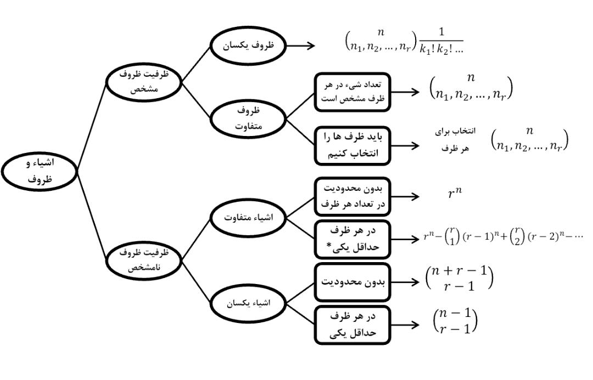

# جلسه اول

۱۴۰۵/۰۷/۲۷

## فصل اول

### جایگشت

#### جایگشت‌های خاص

##### ۱ کنار هم بودن

اگر از $ n $ شیء متمایز بخواهیم $ k $ تا از آن‌ها کنار هم باشند، آن $ k $ تا را در یک بسته به عنوان شیء جدید قرار داده و داریم:

- (جایگشت اشیاء کلی در حال حاضر × جایگشت اشیاء متمایز درون بسته) یا:

$$ (n-k+1)! \times k! $$

##### ۲ کنار هم نبودن: این حالت در واقع متمم حالت قبلی خواهد بود و داریم:

$$ n! - ((n-k+1)! \times k!) $$

##### ۳ یکی در میان قرار دادن اعضای ۲ گروه: ۲ گروه را زمان می‌توان یکی در میان قرار داد که یا تعداد اعضای آن‌ها برابر باشد و یا این تعداد یک واحد اختلاف داشته باشد؛ پس می‌توان گفت:

- یک واحد اختلاف: تنها به یک حالت می‌توان آن‌ها را یکی در میان قرار داد (ΔΟΔΟΔΟΔ)؛ در این صورت جایگشت هر گروه را محاسبه کرده و در هم ضرب می‌کنیم.

- برابری: به دو صورت مختلف می‌توان آن‌ها را قرار داد (ΟΔΟΔΟΔ یا ΔΟΔΟΔΟ)؛ در این صورت جایگشت هر گروه را محاسبه کرده و حاصل کل را ۲ برابر می‌کنیم.

### افراز

#### توضیح

- ما $ n $ تا شیء داریم که متفاوت هستند
- می‌خواهیم این اشیاء را به گروه‌هایی تقسیم کنیم

مثال: ما ۸ تا شیء داریم، می‌خواهیم بین چند طرف تقسیم کنیم؛ ظرف اول ۴ تا، ظرف دوم یکی، و ظرف سوم ۳ تا جا داشته باشد

- حل:

$$ \frac{8!}{4! \times 1! \times 3!} = \frac{40320}{24 \times 1 \times 6} = 280 $$

#### فرمول افراز

$$ \binom{n}{n_1, n_2, ..., n_r} = \frac{n!}{n_1! \times n_2! \times ... \times n_r!} $$

#### توضیح فرمول

##### صورت کسر

- اول فرض می‌کنیم ظروف ثابت هستند
- سپس اشیاء را داخل ظروف جابجا می‌کنیم
- بنابراین صورت کسر $n!$ است

##### مخرج کسر

- در حالت بالا، حالت‌های جایگشت اشیاء داخل ظروف را حساب کرده‌ایم
- باید جایگشت‌های داخل ظروف را کم کنیم
- به طور مثال ظرفی اول که $n_1$ شی داخل آن دارد، اشیاء داخل آن به $n_1!$ حالت مختلف چیده شده‌اند و باید کم بشوند
- به همین صورت برای بقیه ظروف حساب می‌کنیم

### قضیه چندجمله‌ای

$$ (x_1 + x_2 + \dots + x_r)^n = \sum_{\substack{(n_1,n_2,\ldots,n_r) \\ n_1+n_2+\dots+n_r=n \\ n_i \ge 0}}^n \binom{n}{n_1, n_2, \dots, n_r} x_1^{n_1} \dots x_r^{n_r} $$

### اشیاء و ظروف

- مثال: ۶ بازیکن فوتبال داریم، می‌خواهیم آن‌ها را به ۳ تیم دو نفره تقسیم کنیم.
- حل:

$$ n = 6 \quad n_1, n_2, n_3 = 2 $$

$$ \binom{6}{2,2,2} \times \frac{1}{3!} $$

- مثال: ۵ کتاب متمایز را بین ۳ نفر با نام‌های علی، رضا، حسین تقسیم می‌کنیم. علی دو کتاب و رضا دو کتاب و حسین یک کتاب.
- حل:

$$ n = 5 \quad k = 3 $$

$$ n_1, n_2, n_3 = 2, 2, 1 $$

$$ \binom{5}{2,2,1} = \frac{5!}{2! \times 2! \times 1!} = 30 $$

- مثال: همان مثال ۵ کتاب متمایز را بین ۳ نفر با نام‌های علی، رضا، حسین تقسیم می‌کنیم؛ ولی یکی از این افراد یک کتاب و دو نفر دیگر هر کدام دو کتاب دارند.
- حل:

$$ n = 5 \quad k = 3 $$

$$ \binom{3}{1} \times \binom{2}{2} \times \binom{5}{1,2,2} = 3 \times \frac{5!}{1! \times 2! \times 2!} = 90 $$

## سوالات فصل اول

۱- در جعبه‌ای $ m $ مهره با شماره‌های $ 1 $ تا $ m $ وجود دارد. به چند طریق می‌توان $ n $ مهره را از این جعبه انتخاب کرد به طوری که کوچک‌ترین شماره بین اعداد انتخابی برابر با عدد $ a $ باشد؟

$$ (1 \le a \le m - n + 1) $$

- حل:
- مهره شماره $ a $ باید حتماً انتخاب شود.
- هیچ مهره‌ای از شماره‌های $ 1 $ تا $ a-1 $ نباید انتخاب شود.
- $ n-1 $ مهره باقی‌مانده باید از بین مهره‌های با شماره $ a+1 $ تا $ m $ انتخاب شوند.
- تعداد مهره‌های بزرگتر از $ a $ برابر با $ m-a $ است.
- بنابراین، تعداد کل حالت‌ها برابر است با:

$$ \binom{m-a}{n-1} $$

---

۲- با ارقام $ 0 $ تا $ 9 $ چند عدد $ 3 $ رقمی با ارقام غیرتکراری می‌توان ساخت به طوری که:
- الف) رقم صدگان < دهگان < یکان باشد.
- ب) مجموعه ارقام برابر $ 12 $ باشد.

- حل الف:
- از بین ارقام $ 0 $ تا $ 9 $، سه رقم انتخاب می‌کنیم.
- ترتیب قرارگیری ارقام انتخاب‌شده به صورت یکتا مشخص می‌شود.

$$ \binom{10}{3} = 120 $$

- حل ب:
- مجموعه‌های سه‌تایی متمایز با مجموع $ 12 $:
- با حضور صفر: $ \{0,3,9\}, \{0,4,8\}, \{0,5,7\} $
- بدون حضور صفر: $ \{1,2,9\}, \{1,3,8\}, \{1,4,7\}, \{1,5,6\}, \{2,3,7\}, \{2,4,6\}, \{3,4,5\} $
- برای هر مجموعه بدون صفر، تعداد حالت‌ها برابر با $ 3! = 6 $ است.
- برای هر مجموعه با صفر، تعداد حالت‌ها برابر با $ 2 \times 2! = 4 $ است.

$$ 7 \times 6 + 3 \times 4 = 54 $$

---

۳- چند عدد ۵ رقمی می‌توان نوشت که دو رقم سمت چپ بر ۱۷ و کل عدد بر ۵ بخش‌پذیر باشد؟
- دو رقم سمت چپ یکی از مضارب دو رقمی ۱۷ هستند: $ 17, 34, 51, 68, 85 $ ($ 5 $ حالت).
- رقم یکان برای بخش‌پذیری بر ۵ باید $ 0 $ یا $ 5 $ باشد.

- الف) با تکرار ارقام
- حل:

$$ 5 \times 10 \times 10 \times 2 = 1000 $$

- ب) بدون تکرار ارقام
- حل:
- دو رقم سمت چپ یکی از مضارب دو رقمی $ 17 $ هستند: $ 17, 34, 51, 68, 85 $.
- رقم یکان برای بخش‌پذیری بر $ 5 $ باید $ 0 $ یا $ 5 $ باشد.

- اگر رقم یکان $ 0 $ باشد:
- هر $ 5 $ پیشوند مجاز هستند.
- از $ 10 $ رقم، $ 3 $ رقم استفاده شده و $ 7 $ رقم باقی می‌ماند.

$$ 5 \times 7 \times 6 = 210 $$

- اگر رقم یکان $ 5 $ باشد:
- پیشوندهای حاوی $ 5 $ یعنی $ 51 $ و $ 85 $ حذف می‌شوند ($ 3 $ پیشوند باقی می‌ماند).
- از $ 10 $ رقم، $ 3 $ رقم استفاده شده و $ 7 $ رقم باقی می‌ماند.

$$ 3 \times 7 \times 6 = 126 $$

- مجموع کل حالت‌ها:

$$ 210 + 126 = 336 $$

---

۴- بین اعداد ۱ تا ۱۰۰۰۰ چند عدد وجود دارد که در آن حداقل دو رقم متوالی یکسان باشند.
- حل: تعداد کل را منهای تعداد اعداد بدون دو رقم متوالی یکسان می‌کنیم.
- عدد $ 10000 $ دارای دو رقم متوالی یکسان است.

$$ 10000 - (9 + 9^2 + 9^3 + 9^4) = 10000 - 7380 = 2620 $$