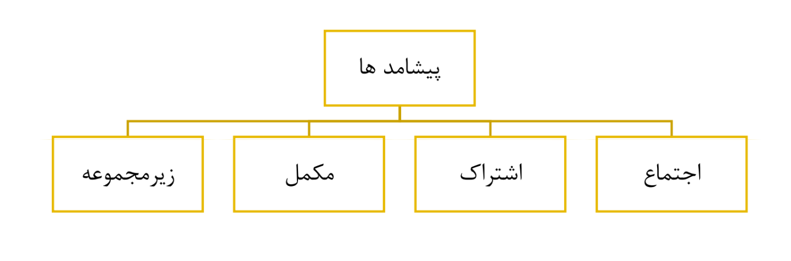
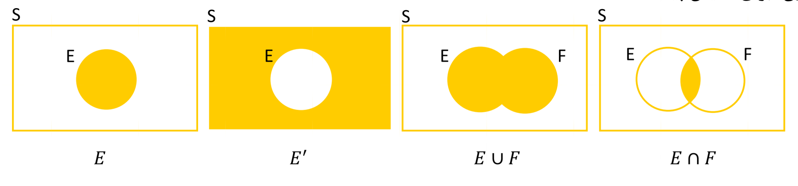
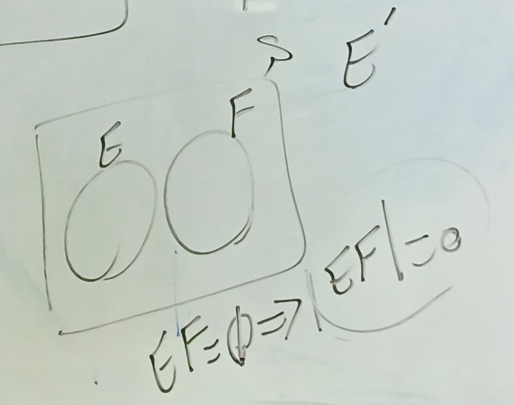

# جلسه پنجم

۱۴۰۵/۰۷/۲۱

(جلسه قبل برگزار نشد)

## ادامه فصل اول

مثال: چند جواب متمایز غیر منفی صحیح برای معادله $ x_1 + x_2 = 3 $ وجود دارد؟

- حل:

$$ \binom{3+2-1}{2-1} = 4 $$

- جواب ها: $ (0,3) \ , \ (1,2) \ , \ (2,1) \ , \ (3,0) $

---

مثال: سرمایه گذاری میخواهد ۲۰ میلیون تومان را در ۴ زمینه متفاوت سرمایه گذاری کند و در هر زمینه باید مضربی از یک میلیون تومان سرمایه گذاری شود.

الف) اگر او بخواهد همه ۲۰ میلیون تومان را سرمایه گذاری کند، چند روش مختلف وجود دارد؟

ب) اگر لازم نباشد همه ی سرمایه را مصرف کند، چند روش وجود دارد؟

- حل:

الف)

$$ x_1 + x_2 + x_3 + x_4 = 20 \ ; \ x_i \ge 0 $$

$$ \binom{20+4-1}{4-1} = \binom{23}{3} = 1771 $$

ب)

$$ x_1 + x_2 + x_3 + x_4 \le 20 \ ; \ x_i \ge 0 \Rightarrow x_1 + x_2 + x_3 + x_4 + x_5' = 20 \ ; \ x_i \ge 0 \ ; \ x_5' \ge 0 $$

$$ \binom{20+5-1}{5-1} = \binom{24}{4} = 10626 $$

$x_5'$ متغیر لنگی (slack variable)

## فصل دوم، اصول احتمال

### فضای نمونه‌ای $(S)$

مجموعه تمام نتایج ممکن برای یک آزمایش تصادفی

---

مثال: یک خانواده قرار است بچه بدنیا بیاورد، حالت‌های جنسیت کودک

$$
S = \{b,g\} \\ E = \{b\} \quad , \quad F = \{g\}
$$

---

مثال: فضای نمونه ای نتیجه ترتیب برنده شدن در یک مسابقه اسب سواری شامل ۷ سوارکار

- حل:

- نتیجه ۱: ۱ و ۲ و ۳ و ۴ و ۵ و ۶ و ۷
- نتیجه ۲: ۲ و ۱ و ۳ و ۴ و ۵ و ۶ و ۷
- ...
- نتیجه ۷!

$$ S = \{\text{تمام 7! ترتیب ممکن از اعداد ۱ تا ۷} \} $$

$$
|S| = 7!
$$

---

مثال: فضای نمونه ای نتیجه پرتاب ۲ سکه

- حل:

- سکه میتواند شیر (H) و یا خط (T) باشد.

$$ S = \{(H,H), (T,T), (H,T), (T,H)\} $$

$$
|S| = 4
$$

---

مثال: فضای نمونه ای نتیجه پرتاب ۲ تاس

- حل:

$$ S = \{(i,j) \mid i,j = 1,2,3,4,5,6\} $$

$$
|S| = 36
$$

---

مثال: فضای نمونه ای نتیجه طول عمر یک ترانزیستور (بر حسب ساعت)

- حل:

$$ S = \{ x \mid 0 \le x < \infty \} $$

---

### پیشامد

- هر زیرمجموعه $ E $ از فضای نمونه ای را یک پیشامد گویند؛ به بیانی دیگر پیشامد مجموعه ای است که اعضای آن برخی از نتایج آزمایش هستند.

- نکته: اگر نتیجه ای از آزمایش در $ E $ باشد آنگاه گفته میشود $ E $ رخ داده است.

---

مثال: پیشامد دختر بودن نوزاد

- حل:

$$ S = \{g, b\} \rightarrow E = \{g\} $$

---

مثال: پیشامد ظاهر شدن شیر در پرتاب اول

- حل:

$$ S = \{(H,H), (T,T), (H,T), (T,H)\} \rightarrow E = \{(H,H), (H,T)\} $$

- پیشامد اینکه در پرتاب دو سکه حداقل ۱ شیر ظاهر شود:

$$ S = \{(H,H), (T,T), (H,T), (T,H)\} \rightarrow E = \{(H,H), (H,T), (T,H)\} $$

---

مثال: پیشامد اینکه ترانزیستور حداکثر ۵ ساعت عمر کند

- حل:

$$ S = \{ x \mid 0 \le x < \infty \} \rightarrow E = \{ x \mid 0 \le x \le 5 \} $$

### عملگرهای مجموعه‌ها (جبر مجموعه‌ها)

- اجتماع
- اشتراک
- متمم
- دمورگان

#### اجتماع دو پیشامد

- $ E \cup F $ را اجتماع دو پیشامد $ E $ و $ F $ می‌نامیم هرگاه اعضای آن عضو $ E $ یا $ F $ یا هر دو باشد. (اعضای آن حداقل در یکی از $ E $ و $ F $ باشد.)

$$ E \cup F = \{ x \mid x \in E \ \text{یا} \ x \in F \} $$

- مثال: پیشامد ظاهر شدن حداقل یک شیر در دو پرتاب

- حل:

$$ F = \{(T,H), (H,H)\} $$

$$ E = \{(H,H), (H,T)\} $$

$$ F \cup E = \{(H,H), (H,T), (T,H)\} $$

#### اشتراک دو پیشامد

- $ E \cap F $ یا $ EF $ را اشتراک دو پیشامد $ E $ و $ F $ می‌نامیم هرگاه شامل همه نتایجی باشد که در $ E $ و $ F $ وجود دارد.

$$ E \cap F = \{ x \mid x \in E \ \text{و} \ x \in F \} $$

مثال: در پرتاب دو سکه، پیشامد $ E $ ظاهر شدن شیر در پرتاب اول و پیشامد $ F $ ظاهر شدن شیر در پرتاب دوم است. $ EF $ را بیابید.

- حل:

$$ E = \{(H,H), (H,T)\} $$

$$ F = \{(H,H), (T,H)\} $$

$$ EF = \{(H,H)\} $$

- مثال: پیشامد این که مجموع ۲ تاس ۷ و ۶ باشد.

- حل:

$$ F = \{(1,6), (2,5), (3,4), (4,3), (5,2), (6,1)\} \ ; \ |F|=6 $$

$$ E = \{(1,5), (2,4), (3,3), (4,2), (5,1)\} \ ; \ |E|=5 $$

$$ EF = \{\} = \varnothing $$

- تعریف: دو پیشامد $ E $ و $ F $ ناسازگارند اگر $ EF = \varnothing $ باشد.

 - نکته: پیشامدهای ناسازگار باهم وابسته هستند (مطالب فصل سوم)
 - نکنه: پیشامدهایی که ناسازگار نیستند ممکن است وابسته باشند و ممکن است وابسته نباشند

#### پیشامد مکمل

- $ E^C $ یا $ E' $ شامل تمامی نقاط فضای نمونه ای است که در $ E $ حضور ندارند.

$$ E' = \{ x \mid x \notin E \ \text{و} \ x \in S \} $$

- نکته:

$$ S' = \varnothing $$

---

مثال: در پرتاب دو سکه، پیشامد $ E $ ظاهر شدن حداقل یک شیر است. $ E $ و $ E' $ را بنویسید.

- حل:

$$ S = \{(H,H), (T,T), (H,T), (T,H)\} $$

$$ E = \{(H,H), (H,T), (T,H)\} $$

$$ E' = \{(T,T)\} $$

#### پیشامد زیر مجموعه

- برای دو پیشامد $ E $ و $ F $ اگر همه نقاط $ E $ در $ F $ باشد، گوییم $ F $ شامل $ E $ است و $ E \subset F $

$$ E \subset F \iff \forall x \in E \Rightarrow x \in F $$

- در اینصورت اگر $ E $ رخ دهد لزوما $ F $ هم رخ داده است.

- نکته:

$$ E \subset F \ \text{و} \ F \subset E \iff E = F $$

#### دیاگرام ون (برای نمایش پیشامدها)

### چند خاصیت و رابطه مهم

- قانون جا به جایی:

$$ \begin{cases} E \cup F = F \cup E \\ EF = FE \end{cases} $$

- قانون شرکت پذیری:

$$ \begin{cases} (E \cup F) \cup G = E \cup (F \cup G) \\ (EF)G = E(FG) \end{cases} $$

- قانون توزیع پذیری:

$$ \begin{cases} (E \cup F)G = EG \cup FG \\ (EF) \cup G = (E \cup G)(F \cup G) \end{cases} $$

- قانون دمورگان:

$$ \begin{cases} \left( \bigcup_{i=1}^{n} E_i \right)' = \bigcap_{i=1}^{n} E_i' \\ \left( \bigcap_{i=1}^{n} E_i \right)' = \bigcup_{i=1}^{n} E_i' \end{cases} $$

- نمونه دمورگان

$$ \begin{cases}(A \cap B)' = A' \cup B' \\ (A \cup B)' = A' \cap B' \end{cases} $$

### اصول احتمال

- یکی از راه های ممکن برای بدست آوردن احتمال یک پیشامد، استفاده از فراوانی نسبی میباشد. برای اینکار:

- احتمال وقوع پیشامد $ E $ برابر است با تعداد دفعاتی از انجام آزمایش که پیشامد $ E $ رخ میدهد، $ n(E) $، به کل تعداد دفعات انجام آزمایش، $ n $. هرگاه شرایط انجام آزمایش در هر تکرار یکسان بوده و تعداد دفعات آزمایش به بینهایت میل کند.

$$ P(E) = \lim_{n \to \infty} \frac{n(E)}{n} $$

### اصول موضوعه کولموگروف

1. $ 0 \le P(E) \le 1 $

2. $ P(S) = 1 $

3. $ \forall i,j \ ; \ i \neq j \ , \ E_i E_j = \varnothing \ ; \ P(\bigcup_{i=1}^{n} E_i) = \sum_{i=1}^{n} P(E_i) $

توضیح ۳: اگر دو پیشامد ناسازگار داشته باشیم، احتمال وقوع $E$ یا $F$ برابر است با $P(E)+P(F)$

---

مثال: در پرتاب یک سکه فرض میکنیم آمدن شیر و خط هم شانس باشد. احتمال آمدن شیر و خط را محاسبه کنید:

- حل:

- شیر و خط هم شانس هستند پس احتمالشان با یکدیگر برابر است، همچنین این ۲ پیشامد ناسازگارند پس اشتراک ندارند.

$$ S = \{H, T\} = \{H\} \cup \{T\} $$

$$ P(\{H\}) = P(\{T\}) = x $$

$$ S = \{H\} \cup \{T\} $$

$$ P(S) = P(\{H\} \cup \{T\}) = P(\{H\}) + P(\{T\}) $$

$$ 1 = 2x \Rightarrow x = \frac{1}{2} $$