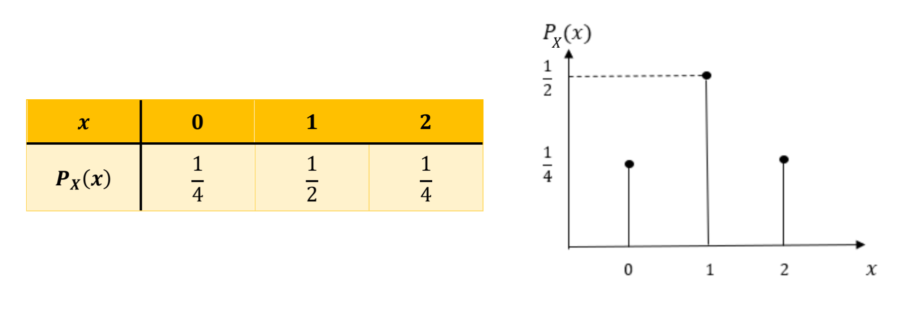
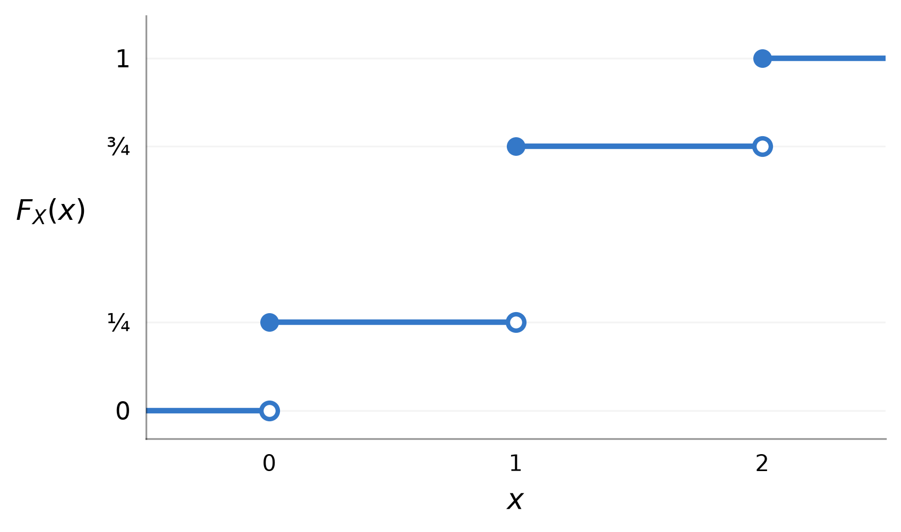

# جلسه شانزدهم

۱۴۰۵/۰۹/۰۴

## فصل ۴: متغیرهای تصادفی (گسسته)

### تعریف متغیر تصادفی

یک تابع (نگاشت) از فضای نمونه‌ای به مجموعه اعداد حقیقی

- متغیر تصادفی که مقدار نگرفته با حروف بزرگ نمایش داده می‌شود
- متغیر تصادفی زمانی که مقدار بگیرد با حروف کوچک نمایش داده می‌شود

$$
X = \text{میزان برد در پرتاب یک تاس}\\
X \in \{1,2,3,4,5,6\}
$$

$$
\begin{aligned}
x(1) &= 1\\
x(2) &= 2\\
x(3) &= 3\\
x(4) &= 4\\
x(5) &= 5\\
x(6) &= 6
\end{aligned}
$$

#### انواع متغیرهای تصادفی

۱. گسسته: برد شمارا است.
   - مثال: تعداد افرادی که در روز وارد یک سامانه می‌شوند.

۲. پیوسته: برد شمارا نیست.
   - مثال: ساعاتی که یک ژنراتور کار می‌کند.

---

مثال: آزمایش شامل پرتاب ۳ سکه منظم را در نظر بگیرید. اگر $ Y $ نشان دهنده‌ی تعداد شیرهای ظاهر شده باشد مقادیر ممکن برای $ Y $ و احتمالات وقوع آن را بدست آورید.

- حل:

$$ Y \in \{0, 1, 2, 3\} $$

$$ P\{Y = 0\} = P\{(T, T, T)\} = \frac{1}{8} $$

$$ P\{Y = 1\} = P\{(H, T, T), (T, H, T), (T, T, H)\} = \frac{3}{8} $$

$$ P\{Y = 2\} = P\{(H, H, T), (H, T, H), (T, H, H)\} = \frac{3}{8} $$

$$ P\{Y = 3\} = P\{(H, H, H)\} = \frac{1}{8} $$

$$ P\{Y = 0\} + \cdots + P\{Y = 3\} = 1 $$

---

مثال: سه توپ را به طور تصادفی و بدون جایگذاری از ظرفی که شامل ۲۰ توپ از شماره های ۱ تا ۲۰ است انتخاب میکنیم احتمال اینکه حداقل یکی از توپ های انتخاب شده عددی بزرگتر یا مساوی ۱۷ باشد را محاسبه کنید.

- حل:

- $ X $: بزرگترین عدد ظاهر شده $ \in \{3, 4, 5, \ldots, 20\} $

$$ P(X = i) = \frac{\binom{i-1}{2}}{\binom{20}{3}} \ ; \ i = 3, 4, \ldots, 20 $$

$$ P(X \ge 17) = P(X = 17) + \cdots + P(X = 20) $$

$$ = \frac{\binom{16}{2}}{\binom{20}{3}} + \frac{\binom{17}{2}}{\binom{20}{3}} + \frac{\binom{18}{2}}{\binom{20}{3}} + \frac{\binom{19}{2}}{\binom{20}{3}} = 0.508 $$

---

مثال: آزمایش های ساده ی مستقل شامل پرتاب یک سکه را آنقدر تکرار میکنیم تا یک شیر (با احتمال $ P $) ظاهر شود یا جمعا $ n $ پرتاب انجام شود. اگر $ X $ نشان دهنده‌ی تعداد دفعات پرتاب باشد، مقادیر ممکن برای $ X $ و احتمالات وقوع آن را بدست آورید.

- حل:

$$ X \in \{1, 2, \ldots, n\} $$

$$ P(X = 1) = P $$

$$ P(X = 2) = (1 - P)P $$

$$ P(X = 3) = (1 - P)^2 P $$

$$ \ldots $$

$$ P(X = n - 1) = (1 - P)^{n-2} P $$

$$
\begin{aligned}
P(X=n) &= P(X=n|H_n)P(H_n) + P(X=n|T_n)P(T_n)\\
&= (1-P)^{n-1}P + (1-P)^{n-1}(1-P)\\
&= (1-P)^{n-1}
\end{aligned}
$$

- نکته:

$$ P + (1 - P)P + (1 - P)^2 P + \cdots + (1 - P)^{n-2} P + (1 - P)^{n-1} $$

$$ = P \sum_{i=1}^{n-1} (1 - P)^{i-1} + (1 - P)^{n-1} = P \times \frac{1 - (1 - P)^{n-1}}{1 - (1 - P)} + (1 - P)^{n-1} = 1 $$

---

مثال: سه توپ را به تصادف از ظرفی شامل ۳ توپ سفید، ۳ توپ قرمز و ۵ توپ سیاه انتخاب میکنیم. برای هر توپ سفید انتخاب شده ۱ دلار جایزه و برای هر توپ قرمز انتخاب شده ۱ دلار جریمه می‌شویم. اگر $ X $ نشان دهنده‌ی میزان برد در این آزمایش باشد، مقادیر ممکن و احتمالات آن را بدست آورید.

- حل:

$$ X \in \{0, \pm 1, \pm 2, \pm 3\} $$

$$ Pr(X = 0) = \frac{\binom{5}{3} + \binom{5}{1}\binom{3}{1}\binom{3}{1}}{\binom{11}{3}} = \frac{55}{165} $$

$$ Pr(X = 1) = Pr(X = -1) = \frac{\binom{5}{2}\binom{3}{1} + \binom{3}{2}\binom{5}{1}}{\binom{11}{3}} = \frac{39}{165} $$

$$ Pr(X = 2) = Pr(X = -2) = \frac{\binom{5}{1}\binom{3}{2}}{\binom{11}{3}} = \frac{15}{165} $$

$$ Pr(X = 3) = Pr(X = -3) = \frac{\binom{3}{3}}{\binom{11}{3}} = \frac{1}{165} $$

$$ \sum_{i=-3}^{3} Pr(X = i) = 1 $$

---

#### تابع توزیع تجمعی (CDF) یک متغیر تصادفی:

$$ F_X(x) = Pr(X \le x) \ ; \ -\infty < x < +\infty $$

$$ F_X(x)=Pr(X\leq x)=\sum_{y\leq x}p_X(y) $$

$$
\begin{cases}
F_X(-\infty)=0\\
F_X(+\infty)=1\\
0\leq F_X(x)\leq 1\\
F_X \text{ توزیع تجمعی غیرنزولی است}\\
F_X \text{ از راست پیوسته است}
\end{cases}
$$

- نکته:

$$ \text{if } a \le b \rightarrow X \le a \rightarrow X \le b $$

$$ \rightarrow X \le a \subset X \le b \rightarrow Pr(X \le a) \le Pr(X \le b) $$

$$ \rightarrow F_X(a) \le F_X(b) $$

$$ \text{if } a \le b \rightarrow F_X(a) \le F_X(b) $$

- یعنی $ F_X(x) $ تابعی غیر نزولی است.

---

#### متغیرهای تصادفی گسسته:

الف) یک متغیر تصادفی است که مقادیر شما را اختیار میکند.

ب) دارای تابعی است تحت عنوان تابع جرم احتمال $ p_X(x) \leftarrow $ (PMF)

$$ p_X(x) = Pr(X = x) \begin{cases} 0 \le P_X(x) \le 1 \\ \sum_x p_X(x) = 1 \end{cases} $$

- تابع احتمال را معمولا در دستگاه مختصات با محور افقی $ X $ و محور قائم $ p_X(x) $ رسم می‌کنند:

$$
F_X(x)=
\begin{cases}
0 & x<0\\
\frac{1}{4} & 0\leq x<1\\
\frac{3}{4} & 1\leq x<2\\
1 & x\geq 2
\end{cases}
$$

تابع CDF ($F_X$) از راست پیوسته است