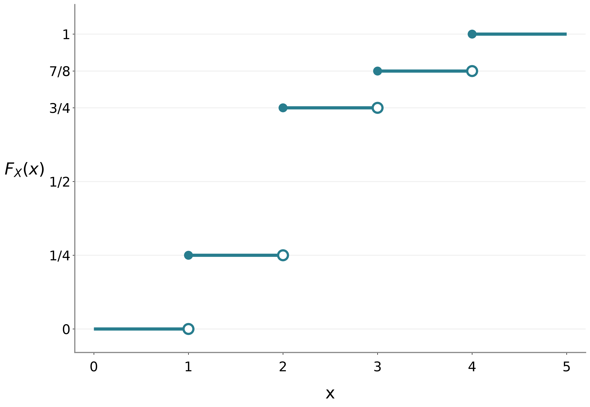

# جلسه هفدهم

۱۴۰۵/۰۹/۰۷

## ادامه فصل ۴

مثال: تابع احتمال متغیر تصادفی $ X $ به صورت زیر است که در آن $ \lambda > 0 $ است:

$$ P_X(x) = \frac{C\lambda^x}{x!} \ ; \ x = 0, 1, \ldots $$

الف) $ P(X = 0) $ را بدست آورید.

ب) $ P(X > 2) $ را بدست آورید.

- حل:

- ابتدا مقدار ثابت $ C $ را محاسبه می‌کنیم. می‌دانیم مجموع احتمال تمام مقادیر ممکن یک متغیر تصادفی گسسته برابر با یک است:

$$ \sum_{x=0}^{+\infty} P_X(x) = 1 $$

$$ \Rightarrow \sum_{x=0}^{+\infty} \frac{C\lambda^x}{x!} = 1 $$

$$ \Rightarrow C \sum_{x=0}^{+\infty} \frac{\lambda^x}{x!} = 1 $$

$$ \Rightarrow C^{-1} = \sum_{x=0}^{+\infty} \frac{\lambda^x}{x!} $$

با استفاده از اتحاد بسط نمایی:

$$ \Rightarrow C^{-1} = e^\lambda \Rightarrow C = e^{-\lambda} $$

الف)

$$ P_X(x) = \frac{e^{-\lambda}\lambda^x}{x!} $$

$$ P(X = 0) = P_X(0) = \frac{e^{-\lambda}\lambda^0}{0!} = e^{-\lambda} $$

ب)

$$ P(X > 2) = 1 - P(X \leq 2) $$

$$ = 1 - [P(X = 0) + P(X = 1) + P(X = 2)] $$

$$ = 1 - \left\{ e^{-\lambda} + \lambda e^{-\lambda} + \frac{\lambda^2}{2}e^{-\lambda} \right\} $$

$$ \boxed{P(X > 2) = 1 - e^{-\lambda}\left(1 + \lambda + \frac{\lambda^2}{2}\right)} $$

---

- نکته ۱: میتوان تابع CDF را با استفاده از PMF محاسبه نمود:

$$ F_X(x) = Pr(X \le x) = \sum_{y \le x} Pr(X = y) = \sum_{y \le x} Pr(y) $$

- نکته ۲: اگر $ X $ یک متغیر تصادفی گسسته با مقادیر $ x_1, x_2, x_3, \ldots $ باشد به طوری که $ x_1 < x_2 < x_3 < \ldots $ آنگاه تابع توزیع تجمعی $ X $ پله ای است؛ یعنی در بازه ی $ (x_{i-1}, x_i) $ ثابت بوده و در $ x_i $ پرشی به اندازه ی $ P_X(x_i) $ خواهد داشت.

---

مثال: تابع $ F_X(x) $ را برای $ x $ با تابع احتمال زیر رسم کنید.

| $ x $ | 1 | 2 | 3 | 4 |
| :---: | :---: | :---: | :---: | :---: |
| $ P_X(x) $ | $ \frac{1}{4} $ | $ \frac{1}{2} $ | $ \frac{1}{8} $ | $ \frac{1}{8} $ |

- حل:

$$ F_X(x) = \begin{cases} 0 & x < 1 \\ \frac{1}{4} & 1 \le x < 2 \\ \frac{3}{4} & 2 \le x < 3 \\ \frac{7}{8} & 3 \le x < 4 \\ 1 & 4 \le x \end{cases} $$

---

### امید ریاضی (مقدار میانگین، متوسط، مقدار انتظاری):

- برای متغیر تصادفی گسسته ی $ X $ با تابع احتمال $ P_X(x) $ امید ریاضی با نشان داده شده و برابر است با:

$$ E[X] = \sum_x x P_X(x) $$

- مفهوم امید ریاضی در واقع یک میانگین وزنی از مقادیر ممکن $ X $ در آن مقدار اختیار می کند. همچنین مفهوم امید ریاضی را می توان معادل مفهوم مرکز ثقل توزیع جرمی در نظر گرفت، هرگاه جرم هر نقطه را معادل احتمال آن نقطه در نظر بگیریم.

---

- مثال: برای متغیر تصادفی زیر، $ E[X] $ را محاسبه کنید.

| $ x $ | 1 | 2 | 3 |
| :---: | :---: | :---: | :---: |
| $ P_X(x) $ | $ \frac{1}{4} $ | $ \frac{1}{2} $ | $ \frac{1}{4} $ |

- حل:

$$ E[X] = \sum_x x P_X(x) = 1 \left( \frac{1}{4} \right) + 2 \left( \frac{1}{2} \right) + 3 \left( \frac{1}{4} \right) = 2 $$

---

- مثال: مقدار $ E[X] $ را وقتی نتیجه پرتاب یک تاس منظم را بدست آورید.

$$ E[X] = \sum_{x=1}^{6} x P_X(x) = \sum_{x=1}^{6} x \left( \frac{1}{6} \right) = \frac{1}{6} \sum_{x=1}^{6} x = \frac{1}{6} \times \frac{6 \times 7}{2} = 3.5 $$

---

- مثال: به یک شرکت کننده در مسابقه، دو سوال ۱ و ۲ داده می شود. او می تواند با انتخاب خود به ترتیبی که می خواهد به سوالات پاسخ دهد. اگر او تصمیم بگیرد که سوال $ i $ ($ i = 1, 2 $) را اول پاسخ دهد، در صورتی می تواند سوال $ i \neq j $ را پاسخ دهد که پاسخ $ i $ را صحیح داده باشد. اگر پاسخ اولیه او صحیح نباشد، مجاز نیست به سوال بعدی پاسخ دهد. در صورت پاسخ صحیح به سوال $ i $ به اندازه $ V_i $ دریافت می کند. اگر احتمال اینکه پاسخ سوال $ i $ را بتواند با $ P_i $ نشان داده می شود، چه سوالی را اول انتخاب کند تا امید ریاضی جایزه او حداکثر شود؟ فرض کنید پیشامدهای اینکه او پاسخ هر سوال را بداند از هم مستقل باشد.

- حل:

1 به 2

$$ X_1 = \begin{cases} 0 & 1 - P_1 \\ V_1 & P_1(1 - P_2) \\ V_1 + V_2 & P_1 P_2 \end{cases} \rightarrow E[X] = V_1 P_1(1 - P_2) + P_1 P_2(V_1 + V_2) $$

2 به 1

$$ X_2 = \begin{cases} 0 & 1 - P_2 \\ V_2 & P_2(1 - P_1) \\ V_2 + V_1 & P_2 P_1 \end{cases} \rightarrow E[X] = V_2 P_2(1 - P_1) + P_2 P_1(V_2 + V_1) $$

$$ \text{if } E[X_1] \ge E[X_2] \rightarrow V_1 P_1(1 - P_2) \ge V_2 P_2(1 - P_1) $$

$$ \frac{V_1 P_1}{1 - P_1} \ge \frac{V_2 P_2}{1 - P_2} \rightarrow \text{شرط انتخاب سوال اول} $$